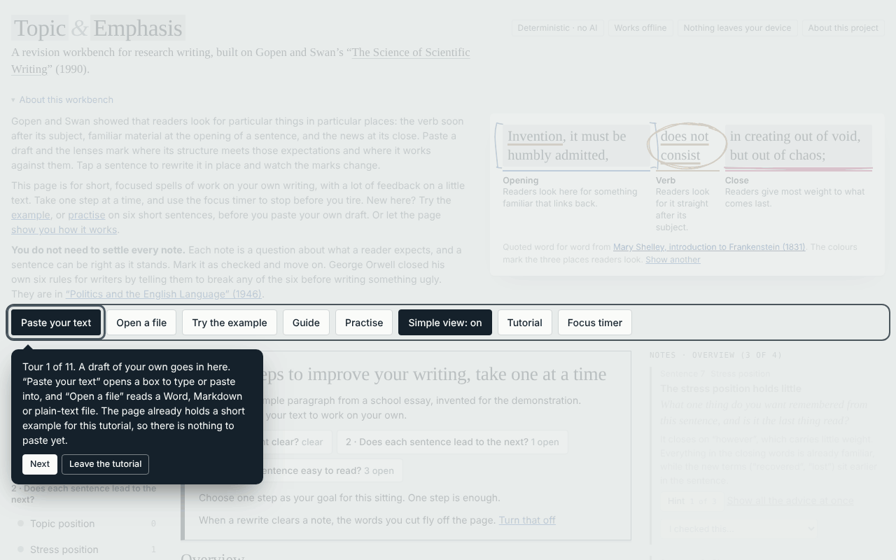

# Topic & Emphasis

[](https://www.repostatus.org/#active)
[](LICENSE)


[](https://github.com/benmarwick/topic-and-emphasis/actions/workflows/ci.yml)

**Topic & Emphasis** is a browser workbench for revising **research writing**. Paste a draft and it marks where the structure of each sentence and paragraph meets, or misses, what readers expect, following Gopen and Swan's ["The Science of Scientific Writing"](https://www.americanscientist.org/node/924) (1990). You then rewrite each sentence in place and watch the notes clear. It is written for **students working on their own**, in the social sciences in particular.

Every mark and note comes from a **fixed rule**. The same text always gets the same marks, and **your draft is never uploaded**. The application is a **single HTML file** whose rules work offline once it has loaded. Everything else is optional, off until you ask for it, and never makes a note: an **optional meaning model**, a small language model that runs entirely in the browser (see below), and **optional data** fetched from the same site (word norms, the Academic Word List, the Academic Formulas List and a phrase bank). The only text that can leave the page is a phrase you select and choose to look up in SkELL or Linggle.

**Use it online:** <https://benmarwick.github.io/topic-and-emphasis/>



---

## 📝 Citation

If you use Topic & Emphasis in teaching or research, please cite it:

> Marwick, B. (2026). *Topic & Emphasis: A revision workbench for research writing* (Version 0.48.0) [Computer software]. https://github.com/benmarwick/topic-and-emphasis

In text: (Marwick 2026).

```bibtex
@software{marwick_topic_emphasis_2026,
  author  = {Marwick, Ben},
  title   = {Topic \& Emphasis: A revision workbench for research writing},
  year    = {2026},
  version = {0.48.0},
  url     = {https://github.com/benmarwick/topic-and-emphasis}
}
```

Please also cite the article the workbench is built on:

> Gopen, G. D., & Swan, J. A. (1990). The science of scientific writing. *American Scientist*, 78(6), 550–558. [Full text](https://www.americanscientist.org/node/924)

---

## 📦 Installation

**Option A: use it online.** Open <https://benmarwick.github.io/topic-and-emphasis/>. Nothing to install.

**Option B: download one file.** Save [`index.html`](index.html) from this repository and open it in a browser. It runs from your own disk. It loads its typefaces from Google Fonts when a connection is available and falls back to system fonts when not. The rules and the built-in word lists all work in a copy saved this way. The optional extras do not, because they are separate files: the meaning model needs `model/`, the second reading in Subject → verb needs `lib/`, and the word norms, the Academic Word List, the Academic Formulas List, the part-of-speech lexicon and the phrase bank need `data/`. For those, use the online copy or serve a clone of the repository from a local web server (`python3 -m http.server`). The two lists can also be pasted into a saved copy by hand.

**Option C: build from source.** The page is assembled from the pieces in `src/` by a short Python script with no dependencies.

```sh
git clone https://github.com/benmarwick/topic-and-emphasis.git
cd topic-and-emphasis
python3 build.py        # writes index.html
for t in tests/*.js; do node "$t" || break; done   # optional: the test files
```

Requires Python 3. The tests need Node.js 18 or later and no packages. `tests/smoke.js` checks the rule engine and `tests/mcp.test.js` the MCP server; the others each cover one feature (readability figures, citations, the main-verb probe, document blocks, the point of a paragraph, the noun unpacker, Word export, the pictures' data, the phrase bank, pasted lists, the two published lists, move order, the nine reviser's checks, the built-in keyword and style lists, and the part-of-speech lexicon).

---

## 🚀 Quick Start

1. **Paste your text**, or choose **Try the example** for seven sentences with five notes to clear. **Tutorial** tours the page and then walks you through them.
2. **Pick a lens** from the list. Each lens reads the draft for one thing and marks it in the text. The Overview shows every open note at once and suggests where to start.
3. **Tap a sentence** to open the workbench under its paragraph. Read the note, rewrite the sentence in the box, and the marks update as you type. Where a note offers a change, preview it before you accept it.
New to revising? Press **Simple view** for eight lenses in three steps, with three notes at a time. A link that ends in `#simple` opens the page that way.

4. **Check your progress** in Before & after, which shows what your revising has changed, and copy the revised text when you are done.

To find a lens, type part of its name in the box above the list. The **Guide** explains every lens on one searchable page: what it reads, what its marks mean, what the research says, where its limits are, and its sources in full.

You do not need to clear every note. A note is a question about the sentence, and "I checked this" is a valid answer.

---

## 🖼️ Gallery

Sixteen of the pictures the page draws. Each is a capture of the real page reading the example draft from its Guide, a short constructed paper on rent caps with one off-topic paragraph about glaciers planted in it. Select a picture to see it at full size (1600 × 1200).

<table>
<tr><th colspan="4" align="left">On the page</th></tr>
<tr>
<td width="25%" valign="top"><a href="docs/gallery/trunk.png"></a><br><b>Trunk view</b><br><sub>Subject → verb lens</sub><br>The subject and verb of each sentence marked, and what the sentence could lose set in grey.</td>
<td width="25%" valign="top"><a href="docs/gallery/topic-grid.png"></a><br><b>Topic grid</b><br><sub>Topic grid lens</sub><br>Which terms the draft keeps using, and whether each comes before the main verb or after it.</td>
<td width="25%" valign="top"><a href="docs/gallery/link-ladder.png"></a><br><b>Link ladder</b><br><sub>Old → new lens</sub><br>Each sentence as a line, joined to the one before wherever it repeats one of its words.</td>
<td width="25%" valign="top"><a href="docs/gallery/typographic-role.png"></a><br><b>Typographic view</b><br><sub>Load map</sub><br>The parts of each sentence shown by type alone: opener in italic, subject in small capitals, verb in heavy type.</td>
</tr>
<tr><th colspan="4" align="left">Load, measures and word choice</th></tr>
<tr>
<td width="25%" valign="top"><a href="docs/gallery/load-strips.png"></a><br><b>Where the load falls</b><br><sub>Load map</sub><br>Sixteen measures of every sentence on one screen, so a sentence that is high on several at once stands out.</td>
<td width="25%" valign="top"><a href="docs/gallery/abstraction-heatmap.png"></a><br><b>Abstraction heatmap</b><br><sub>Load map · optional data</sub><br>Every sentence as a block, darker the more concrete its words.</td>
<td width="25%" valign="top"><a href="docs/gallery/concrete-charged.png"></a><br><b>Abstract or concrete, calm or charged</b><br><sub>Load map · optional data</sub><br>Each sentence placed by how concrete and how arousing its words are.</td>
<td width="25%" valign="top"><a href="docs/gallery/profile-sparklines.png"></a><br><b>Research profile</b><br><sub>Overview</sub><br>Counts from published research, each with a sparkline: the measure for every sentence, at the size of a word.</td>
</tr>
<tr><th colspan="4" align="left">Argument, stance and rhythm</th></tr>
<tr>
<td width="25%" valign="top"><a href="docs/gallery/toulmin.png"></a><br><b>Toulmin layout</b><br><sub>Claim tracer lens</sub><br>The argument as a diagram, drawn from the sentences the writer puts in each box.</td>
<td width="25%" valign="top"><a href="docs/gallery/hedges-boosters.png"></a><br><b>Hedges against boosters</b><br><sub>Hedging lens</sub><br>Caution and confidence side by side for each section, on one scale.</td>
<td width="25%" valign="top"><a href="docs/gallery/draft-as-line.png"></a><br><b>The draft as a line</b><br><sub>Length &amp; rhythm lens</sub><br>Each sentence is a straight run as long as its words, and the line turns right at every full stop.</td>
<td width="25%" valign="top"><a href="docs/gallery/outline-proportions.png"></a><br><b>Outline with proportions</b><br><sub>Reverse outline lens</sub><br>The first sentence of each paragraph, over a rule as long as the paragraph’s share of the draft.</td>
</tr>
<tr><th colspan="4" align="left">Revision, and the optional meaning model</th></tr>
<tr>
<td width="25%" valign="top"><a href="docs/gallery/revision-arrows.png"></a><br><b>Where each rewritten sentence started</b><br><sub>Load map · after a revision</sub><br>Sentence length against lexical density, with a line from where each rewritten sentence was to where it is now.</td>
<td width="25%" valign="top"><a href="docs/gallery/stage-slope.png"></a><br><b>Open notes by stage, start to now</b><br><sub>Before &amp; after lens</sub><br>A slopegraph of what revising has changed, with every number written on the picture.</td>
<td width="25%" valign="top"><a href="docs/gallery/meaning-topics.png"></a><br><b>Meaning views: Topics</b><br><sub>Meaning views · optional AI</sub><br>A streamgraph of which topic each stretch of the draft is about.</td>
<td width="25%" valign="top"><a href="docs/gallery/meaning-map.png"></a><br><b>Meaning views: Map</b><br><sub>Meaning views · optional AI</sub><br>The sentences laid out so that those close in meaning sit close together.</td>
</tr>
</table>

Several of these follow one source closely. The *Typographic view* and *Outline with proportions* are from Brath’s work on type as a carrier of data (Brath 2020, *Visualizing with Text*; [Brath & Banissi 2016](https://doi.org/10.1016/j.sheji.2016.05.003)). The *Link ladder*, the sparklines of the *Research profile*, the slopegraph of *Open notes by stage* and the small multiples of *Where the load falls* follow Tufte: the data is labelled where it sits, with as little legend, grid and frame as it can do without.

Four of the sixteen use the example after a change, so that there is something to show: *Hedges against boosters* has four confident words added to the draft (clearly, certainly, in fact, clearly), and *The draft as a line*, *Where each rewritten sentence started* and *Open notes by stage* use a copy with five passages rewritten. The *Abstraction heatmap* and *Abstract or concrete, calm or charged* need the optional word norms. *Topics*, *Map* and the two bottom rows of *Where the load falls* need the optional meaning model. `tools/make_gallery.py` takes all sixteen from the page, and the Guide inside the page shows these and the rest.

## 🔧 Feature Reference

The page has **33 lenses** in eight groups. A lens reads the draft for one thing, marks it in the text, and may raise notes. Most lenses also carry counts and pictures in cards above the text. Those describe the draft and never raise a note; the ones marked *optional data* stay empty until you load the list they need. The **Guide** inside the page explains every lens, mark and picture, and the [changelog](CHANGELOG.md) records when each arrived.

### Overview

| Lens | What it shows | Drawn from |
|---|---|---|
| Overview | Every open note from every lens, and where to start. Above the text: *The draft at a glance*, the *Research profile*, *Four portraits of the draft*, *Your own model* (the paragraph of your draft with the fewest open notes for its length) and *What is already working* | [Gopen & Swan](https://www.americanscientist.org/node/924); Tufte (1983, 2006) |
| Load map | The whole draft by measure, to find the sentences that carry too much. *Where the load falls*: a strip for each measure and a bar for each sentence. *Structure and vocabulary*: every sentence as a dot, by its length against a measure you choose (lexical density, long words, the wait for the verb; with optional data, word age, part-of-speech density, or concreteness against arousal). *Facets by paragraph*, *Paragraph by paragraph*, and the *Abstraction heatmap* (optional data). *In the text*: fingerprints beside each sentence, and a typographic view that sets the words themselves by a measure. Raises no notes | Tufte (1983, 2006); [Graesser et al. 2011](https://doi.org/10.3102/0013189X11413260); [Oelke et al. (2012)](https://doi.org/10.1109/TVCG.2011.266); [Keim & Oelke (2007)](https://doi.org/10.1109/VAST.2007.4389004); Brath (2020); [Brath & Banissi (2016)](https://doi.org/10.1016/j.sheji.2016.05.003) |
| Guide | Every lens on one searchable page: what it reads, what its marks mean, what the research says and where its limits are. Also a page for instructors, a list of where the pictures are, and where to find wording | — |

### Gopen & Swan's principles

| Lens | What it reads | Counts and pictures above the text | Drawn from |
|---|---|---|---|
| Subject → verb | Words that stand between a subject and its verb | Words before the main verb, sentence by sentence · *Trunk view*: subject and verb marked, openers and asides set lighter · parts of speech, and a second reading of the main verb by another parser (optional data) | [Gopen & Swan](https://www.americanscientist.org/node/924), principle 1; [Gibson (1998)](https://doi.org/10.1016/S0010-0277%2898%2900034-1); [Gu et al. (2024)](https://arxiv.org/abs/2401.10873) |
| Topic position | What opens each sentence, and whether it names the topic | *How your sentences open*: the openings lined up, the most used first · *Whose story the draft tells*: every grammatical subject, by kind | [Gopen & Swan](https://www.americanscientist.org/node/924), principles 3, 4; [Williams (1990)](https://catalog.hathitrust.org/Record/002224980); [Brath & Banissi (2016)](https://doi.org/10.1016/j.sheji.2016.05.003); Brath (2020) |
| Stress position | What closes each sentence, where readers place the emphasis | — | [Gopen & Swan](https://www.americanscientist.org/node/924), principles 2, 7 |
| Old → new | Whether each sentence starts from what the reader already holds | The share of content words already used, and sentences that point back with “this” and a noun · *Link ladder*: each sentence as a line, joined where it repeats a word of the sentence before · nouns that point back (optional data) | [Gopen & Swan](https://www.americanscientist.org/node/924), principles 4, 6; [Haviland & Clark (1974)](https://doi.org/10.1016/S0022-5371%2874%2980003-4); Tufte (1983) |
| Action in verbs | Actions hidden in nouns while the verb says little; the sentences that rest on "be", "have" or a light verb, listed | Nouns made from verbs in every 100 words · *What your sentences do*: every main verb, by kind · verbs hidden in phrases (optional data) | [Gopen & Swan](https://www.americanscientist.org/node/924), principle 5; [Biber & Gray (2010)](https://doi.org/10.1016/j.jeap.2010.01.001); [Hohmann et al. (2025)](https://doi.org/10.1007/s11192-025-05353-8) |

### Is the argument clear?

| Lens | What it reads | Counts and pictures above the text | Drawn from |
|---|---|---|---|
| Reverse outline | The first and last sentence of each paragraph, and the point you say it makes | *Outline with proportions*: the first sentence of each paragraph over a heavy rule as long as the paragraph’s share of the draft · *Try the paragraphs in another order*: drag them, see what each would carry over, and rewrite the draft only when you ask | [Mensh & Kording (2017)](https://doi.org/10.1371/journal.pcbi.1005619); [Morris et al. (2025)](https://doi.org/10.1007/s40593-024-00395-0); [Brath & Banissi (2016)](https://doi.org/10.1016/j.sheji.2016.05.003) |
| Paragraph jobs | The job you give each paragraph, and the moves that job usually needs | How sources are brought in: author first, or in brackets only · *The shape of your argument* · *Paragraph map*: job, length, claim words and point of each paragraph | [Swales (1990)](https://search.worldcat.org/title/23079178); [Academic Phrasebank](https://www.phrasebank.manchester.ac.uk/) |
| Section context | The section each paragraph falls in, read from your headings. Counts by section, and a line on the notes whose advice depends on the section. Raises no notes | The sections found · what each section is doing · the notes that carry a line about their section · whether the literature review joins its sources or lists them | [Swales (1990)](https://search.worldcat.org/title/23079178); [Millar et al. (2013)](https://doi.org/10.1093/applin/ams059); Leong (2014) |
| Claim tracer | Where the words of your central claim and your title appear | *Argument board* · *Toulmin layout*, drawn from the sentences you put in its six parts · the terms of the claim and how often the draft uses them · the sentences the draft is built around | [Toulmin (2003)](https://doi.org/10.1017/CBO9780511840005); [Mihalcea & Tarau (2004)](https://aclanthology.org/W04-3252/); [Reed & Rowe 2005](https://doi.org/10.1007/s10503-005-4416-9) |
| Claim strength | Causal, certain and absolute wording, against the evidence you name | *Wording against evidence* · promotional adjectives in eight groups · charged words, by ratings of valence and arousal (optional data) | [Toulmin (2003)](https://doi.org/10.1017/CBO9780511840005); [Haber et al. (2018)](https://doi.org/10.1371/journal.pone.0196346); [Millar, Batalo & Budgell 2022](https://doi.org/10.1001/jamanetworkopen.2022.28676); [Warriner et al. 2013](https://doi.org/10.3758/s13428-012-0314-x) |
| Hedging | Hedges, and several in a row | *Hedges against boosters*, by section, paragraph or run of sentences · boosters and reader engagement · a second, wider list of hedges · metadiscourse by kind (optional data) | [Hyland (1996)](http://hdl.handle.net/10722/130132); [Hyland 2005](https://doi.org/10.1177/1461445605050365) |

### Does it flow?

| Lens | What it reads | Counts and pictures above the text | Drawn from |
|---|---|---|---|
| Topic grid | Recurring terms across sentences, and how each sentence links back | Thematic progression above each paragraph; referential distance and persistence for each term · *Cohesion map* · *Paragraph ladder*: what each paragraph carries over from the one before · the grid of terms by sentence | [Kinnunen et al. (2012)](https://aclanthology.org/E12-2005/); [Crossley, Kyle & McNamara (2016)](https://doi.org/10.3758/s13428-015-0651-7); [Daneš 1974](https://www.coli.uni-saarland.de/~korbay/Courses/esslli04/Scans/danes74.pdf); [Givón 1983](https://doi.org/10.1075/tsl.3) |
| Signal phrases | Phrases that announce a move, and connectives by type | Connectives by type · transition profile: a connective before the main verb, only after it, or none · sentences that talk about the text itself · *The reader’s skim* · *What kind of text is this?* · the Academic Formulas List and connectives by sense (optional data) | [Swales (1990)](https://search.worldcat.org/title/23079178); [Knight et al. (2020)](https://doi.org/10.17239/jowr-2020.12.01.06); [McNamara et al. (2014)](https://doi.org/10.1017/CBO9780511894664); [Biber, Conrad & Cortes 2004](https://doi.org/10.1093/applin/25.3.371); [Simpson-Vlach & Ellis 2010](https://public.websites.umich.edu/~ncellis/NickEllis/Publications_files/AFL_paper_AppLinxPrepub.pdf) |
| Skeleton read | Only the opening and close of each sentence | *Openings and closes, side by side* | [Gopen & Swan](https://www.americanscientist.org/node/924), principles 2, 3 |
| Meaning views | The whole draft by meaning, in eight views. Needs the optional meaning model, and raises no notes | Thread, Quilt, Topics, Map, Reorder, Ask, Abstract & ending and Drills, described under [Meaning model](#meaning-model-optional) | [Reimers & Gurevych 2019](https://doi.org/10.18653/v1/D19-1410) |

### Is each sentence easy to read?

| Lens | What it reads | Counts and pictures above the text | Drawn from |
|---|---|---|---|
| Length & rhythm | Sentence length on a fixed scale, runs of equal length, readability formulas | Seven readability formulas, run on cleaned text · *Cadence without the words*: a square for each sentence, then only the punctuation · *The draft as a line* · sentence lengths by paragraph on a fixed scale | [Flesch (1948)](https://doi.org/10.1037/h0057532); [Choi & Crossley (2021)](https://easychair.org/publications/preprint/pgb8); [Coleman & Liau 1975](https://doi.org/10.1037/h0076540); [Plavén-Sigray et al. (2017)](https://doi.org/10.7554/eLife.27725); Brath (2020); Posavec |
| Dense phrases | Noun stacks and chains of prepositions; runs of three nouns shown without a note | Noun stacks and preposition chains in every 100 words · lexical density, sentence by sentence · *Phrase net* · parts of speech (optional data) | [Williams (1990)](https://catalog.hathitrust.org/Record/002224980); [Kyle & Crossley (2018)](https://doi.org/10.1111/modl.12468); [Hohmann et al. (2025)](https://doi.org/10.1007/s11192-025-05353-8); [Johansson 2008](https://journals.lub.lu.se/LWPL/article/view/2273) |
| Voice | Passives, and whether each names who acted | Passives that name no agent; pronouns by person | [Gopen & Swan](https://www.americanscientist.org/node/924); [McNamara et al. (2014)](https://doi.org/10.1017/CBO9780511894664) |
| Clutter | Stock phrases, empty openers and stacked negatives | Negation words · fillers · plainer words, and the reading figures the draft would have with them (optional data) | [Zinsser (2006)](https://search.worldcat.org/oclc/62421288); [Williams (1990)](https://catalog.hathitrust.org/Record/002224980) |

### Are the words well chosen?

| Lens | What it reads | Counts and pictures above the text | Drawn from |
|---|---|---|---|
| Vague & worn words | Intensifiers, vague quantities and worn phrases | Words on the excess-vocabulary list · weasel words and buzzwords | [Zinsser (2006)](https://search.worldcat.org/oclc/62421288); [Kobak et al. 2025](https://doi.org/10.1126/sciadv.adt3813) |
| Vocabulary level | Content words against two open word lists, and word variety; optionally, words on the Academic Word List by sublist | Word variety (MTLD, MATTR) · running-word coverage · general science jargon · the Academic Keyword List · *Where your content words come from* · word norms: concreteness, age of acquisition, prevalence and frequency (optional data) | [Browne, Culligan & Phillips (2013)](https://www.newgeneralservicelist.com/); [McCarthy & Jarvis (2010)](https://doi.org/10.3758/BRM.42.2.381); [Coxhead (2000)](https://doi.org/10.2307/3587951); [Nation 2006](https://www.wgtn.ac.nz/__data/assets/pdf_file/0018/1626120/2006-How-large-a-vocab.pdf); [Brysbaert et al. 2014](https://doi.org/10.3758/s13428-013-0403-5); [Kuperman et al. 2012](https://doi.org/10.3758/s13428-012-0210-4) |
| Term tracker | Recurring terms, second names for one thing, and your own word list | Words used only once · reporting words · *Repetition, drawn* · *Term index, in type* · *Word tree* · *Words that mark out each part* | [Williams (1990)](https://catalog.hathitrust.org/Record/002224980); [Kyle, Crossley & Kim (2015)](https://doi.org/10.1075/ijlcr.1.2.01kyl) |
| Acronyms | Abbreviations that are never defined, or used only once or twice | — | [Barnett & Doubleday (2020)](https://doi.org/10.7554/eLife.60080) |
| Describing people | Labels for people that carry a judgment | — | [APA bias-free language guidelines](https://apastyle.apa.org/style-grammar-guidelines/bias-free-language) |

### Is it polished?

| Lens | What it reads | Counts and pictures above the text | Drawn from |
|---|---|---|---|
| Statistics reporting | Reported test results, rechecked by arithmetic; a count of the figures in each sentence | GRIM: a question on any mean that cannot come from whole-number scores for its sample size · *Where the numbers are* | [Nuijten et al. (2016)](https://doi.org/10.3758/s13428-015-0664-2); [Appelbaum et al. (2018)](https://doi.org/10.1037/amp0000191); [Hohmann et al. (2025)](https://doi.org/10.1007/s11192-025-05353-8); [Brown & Heathers 2017](https://doi.org/10.1177/1948550616673876) |
| Mechanical checks | Figure and table order, missing citations, tense | Tense kept from one sentence to the next · *Where each source is cited* · the reference list against the citations in the text | [McNamara et al. (2014)](https://doi.org/10.1017/CBO9780511894664) |
| Typing slips | Doubled words, stray spaces, "a" for "an", look-alike words | A second check of grammar and spelling by Harper (optional) | [Crossley, Bradfield & Bustamante (2019)](https://doi.org/10.17239/jowr-2019.11.02.01) |
| Source overlap | Runs of words shared with a source you paste | *Overlap with a source* | [Crossley, Kyle, Davenport & McNamara (2016)](https://asu.elsevierpure.com/en/publications/automatic-assessment-of-constructed-response-data-in-a-chemistry-) |

### Your progress

| Lens | What it shows | Drawn from |
|---|---|---|
| Before & after | What your revising has changed. The *revision receipt*; open notes by stage, at the start and now; each rewritten sentence labelled as wording only, content added or content removed; the *revision portfolio*; and *Take the draft with you* (export) | Faigley & Witte (1981) |
| Practice | Short drills on each principle, some built from your own draft | [Gopen & Swan](https://www.americanscientist.org/node/924) |

### Research profile

The Overview carries a **Research profile**: 23 counts, grouped under Structure, Vocabulary and density, Cohesion, and Stance and care. Beside eight of them is a sparkline, a line the size of a word that draws the measure for every sentence, so a figure also shows where it peaks. The profile holds counts that writing researchers use to describe a text, each recomputed here by a fixed rule and each shown with the publication it comes from and a line on how to read it. They describe a draft. None is a score and none has a target. The same counts appear in a "Research measure" box inside the lens they belong to, with what the research found and how the rule-based count differs from the published one.

### Optional data and models

Everything in this table is off until you ask for it, is labelled where it shows, and only counts or draws. None of it makes a note or changes the revision receipt. Sources and licences are in [`data/README.md`](data/README.md).

| What | Where it shows | Source |
|---|---|---|
| Word norms: concreteness, age of acquisition, prevalence, frequency | Vocabulary level; Load map (heatmap, word age, typographic view) | [Brysbaert et al. 2014](https://doi.org/10.3758/s13428-013-0403-5); [Kuperman et al. 2012](https://doi.org/10.3758/s13428-012-0210-4); [Brysbaert et al. 2019](https://doi.org/10.3758/s13428-018-1077-9); [Brysbaert & New 2009](https://doi.org/10.3758/BRM.41.4.977) |
| Concreteness of expressions of two words or more | Abstraction heatmap | [Muraki et al. (2022)](https://osf.io/ksypa/) |
| Ratings of valence, arousal and dominance | Claim strength (*Charged words*); Load map (*Abstract or concrete, calm or charged*) | [Warriner et al. 2013](https://doi.org/10.3758/s13428-012-0314-x). The NRC VAD Lexicon can be read from a copy of your own; it is not distributed with the page |
| Academic Word List, Academic Formulas List, or a list you paste | Vocabulary level; Signal phrases | [Coxhead (2000)](https://doi.org/10.2307/3587951); [Simpson-Vlach & Ellis 2010](https://public.websites.umich.edu/~ncellis/NickEllis/Publications_files/AFL_paper_AppLinxPrepub.pdf) |
| Metadiscourse items in ten kinds | Hedging | Hyland (2005), *Metadiscourse* |
| Plain-language pairs and hidden verbs | Clutter; Action in verbs; the last hint on a note | US plain language guidelines |
| Connectives by sense | Signal phrases | Das et al. (2018) |
| Shell nouns | Old → new; the last hint on a “This what?” note | [ycd2016/shellnouns](https://github.com/ycd2016/shellnouns) |
| Phrase bank: about 590 sentence frames in 57 groups | The *Phrases* tab of the workbench | [nashamri/academic-phrases](https://github.com/nashamri/academic-phrases) (GPL-3.0) |
| Part-of-speech lexicon | Subject → verb; Dense phrases; typographic view | [Brill 1992](https://doi.org/10.3115/974499.974526) |
| compromise, a second rule-based parser | Subject → verb (*A second reading*) | [compromise](https://github.com/spencermountain/compromise) |
| Harper, a rule-based grammar and spelling checker | Typing slips | [Automattic](https://github.com/Automattic/harper) |
| Meaning model (AI) | Ten lenses and Meaning views; see below | [Reimers & Gurevych 2019](https://doi.org/10.18653/v1/D19-1410) |
| Entailment model (AI) | Clutter, Claim tracer, Before & after, Source overlap, Meaning views; see below | [nli-deberta-v3-xsmall](https://huggingface.co/Xenova/nli-deberta-v3-xsmall) |

### Meaning model (optional)

Switched off unless the student turns it on. It loads a small sentence-embedding model, all-MiniLM-L6-v2 ([Reimers & Gurevych 2019](https://doi.org/10.18653/v1/D19-1410); [Wang et al. 2020](https://papers.nips.cc/paper/2020/hash/3f5ee243547dee91fbd053c1c4a845aa-Abstract.html)), from the `model/` folder and compares sentences by meaning, following the methods set out by [Kjell, Giorgi & Schwartz (2023)](https://doi.org/10.1037/met0000542). It is a trained language model and therefore a form of AI. It runs in the browser, generates no text, and gives the same result for the same text. The first use downloads about 45 MB.

| Lens | What the model adds |
|---|---|
| Subject → verb | In the trunk view, each opener, interruption and aside is graded by how close the sentence stays to the whole without it, and sentences whose trunk alone says least of the whole are listed |
| Topic grid | Sentences that are close in meaning to the one before but repeat none of its words; how close each paragraph is to the one before, and the weakest join in the draft |
| Old → new | A ribbon picture of each paragraph. Each sentence is divided at its main verb into an opening and a close, and the opening is compared with the close and the opening of the sentence before: a ribbon where it picks up the last close, a dashed line where it keeps the last opening, an amber line where it reaches further back, an open circle for a fresh start |
| Reverse outline | The sentence closest in meaning to the rest of its paragraph, and whether it sits at an edge; the sentence that best carries the point you stated; a strip of dots and a table ranking every sentence of the draft by how far it sits below its own paragraph |
| Claim tracer | The sentence that states your claim most directly, in your words or others; how close each paragraph is to the claim |
| Source overlap | Your sentences closest in meaning to a source sentence, including restatements that share no run of words; the parts of the source the draft says least about |
| Term tracker | The closest pairs in meaning among your terms, as candidates for two names for one thing |
| Before & after | How far each rewritten sentence has moved in meaning from the one it replaced |
| Rewrite box | Two live gauges: how close the sentence you are rewriting is to the one before it, and to your claim |

With the model on, the **Meaning views** lens draws the whole draft in eight ways:

| View | What it shows |
|---|---|
| Thread | Each sentence's closeness to the one before, across the draft, with a second line for closeness to the claim; jumps inside paragraphs, paragraph breaks with no jump, and distant sentences that say nearly the same thing |
| Quilt | Every sentence against every other, shaded by closeness; tap a square to read the two sentences |
| Topics | The model's grouping of sentences into topics, as a streamgraph of each topic's share along the draft, with how often the topic changes |
| Map | Sentences as grey dots on a flat map joined in reading order, each set stronger the closer it is to your claim, with the claim and the earlier positions of rewritten sentences. On first showing the dots are drawn in the order of the sentences. A two-dimensional map distorts, and the view says how much |
| Reorder | Move paragraphs and watch the joins between them; compare with the model's smoothest order; apply an order to the draft |
| Ask | Type a question or a reader's comment and jump to the sentences closest to it. Nothing is generated |
| Abstract & ending | Whether the last paragraph returns to the first, and which paragraphs a pasted abstract says least about |
| Drills | "Which sentence belongs least?" and "Put the paragraph back in order", built from the draft |

The model does not see negation or logic, and its scores only rank things within one draft, so nothing it reports is a pass or a fail. Its results appear as labelled lines, lists and tables. They never become notes, and they do not change the counts of open notes or the revision receipt, which stay rule-based.

An optional **entailment model** ([nli-deberta-v3-xsmall](https://huggingface.co/Xenova/nli-deberta-v3-xsmall), about 90 MB, loaded only when asked for) says of two sentences whether one implies the other, contradicts it, or neither, which closeness in meaning cannot tell apart. It labels pairs of sentences that say the same thing or contradict each other (Clutter), reads the sentences you placed in the Toulmin layout against your claim and lists sentences that read as contradicting it (Claim tracer), says whether a rewrite changed what a sentence says (Before & after), reads your closest sentences against a source (Source overlap), and reads the ending against the opening (Meaning views). It is used only on pairs the meaning model puts close together, because it calls some unrelated sentences contradictions. It is AI, it is labelled as such, and it makes no note.

### Working on a draft

| Feature | What it does |
|---|---|
| Simple view | For writers new to revising: eight lenses in three steps (is my point clear, does each sentence lead to the next, is each sentence easy to read), three notes at a time. It hides and changes no rule: the same text gets the same notes. A link ending in `#simple` opens the page in simple view, and `#step1`, `#step2` or `#step3` opens it at that step |
| Tutorial | A tour of the page, then four notes on the built-in example cleared one at a time, each step with a *Show me* button. A link ending in `#tutorial` starts it |
| Open a file | Word (.docx), Markdown, Quarto, R Markdown, LaTeX or plain text, opened or dragged onto the page and unpacked in the browser. Code, equations, block quotations, settings blocks and the reference list are set aside, greyed and labelled, and no lens reads them |
| Workbench | Rewrite a sentence in place; marks from every open note show inside the box |
| Hints | A note gives its advice only when asked, in up to three hints: where to look, what kind of change, and one way to do it. The last hint can draw on a list you have loaded. “Show all the advice at once” restores the full notes |
| What is already working | Where a sentence keeps its verb beside its subject, opens on a known word or closes on something new, the page says so: in the workbench, in the text and on the Overview |
| Previews | See which notes a suggested change would clear, and any it would bring in, before accepting it |
| Rearrange | Drag the labelled parts of a sentence into a new order; a table shows what the move did to the opening, the subject-to-verb distance and the close |
| Profile | Why this sentence is heavy: each measure for the sentence on the draft's own range, with the draft's middle and the lens to open |
| Unpack the noun | A fill-in template that turns a noun such as "implementation" back into a verb and leaves the actor for the writer to supply |
| Phrases | About 590 sentence frames in 57 groups, opening on the group that fits the paragraph's job or the sentence's move (optional data) |
| Phrase look-up | Sends the words you select, eight at most, to SkELL or Linggle to see them in real use, or copies them for Ludwig |
| Four stages | Narrow the page to argument, flow, polish or calibration, and record each stage as reviewed |
| Focus timer and quiet drafting | A timer for 10, 15, 25 or 45 minutes that reports what changed; a switch that hides the live counts while you write |
| Guided and timed passes | Walk through the notes one at a time, or work for 5, 10 or 20 minutes |
| Before & after | A revision receipt, counts by lens, and the starting text against the current one |
| Export | The text as a Word file with each open note as a margin comment, as a Word file with no comments, or as a plain file; the revision portfolio as a web page, Markdown, JSON or print |
| Practice | Short drills on the principles, some built from your own draft |
| Reading comfort | Text size, spacing and colour settings, and “Still pictures”, which stops the pictures drawing themselves in |
| For instructors | A one-page section of the Guide on using the page in a class, with the links that open a set step |

Each citation above links to its DOI or to the full text where one could be confirmed. Books, and articles whose DOI could not be confirmed, are named without a link. All 194 sources are listed at the foot of the application, 82 of them with a DOI and 78 more with a link to the full text or the publisher's page.

---

## 🔌 MCP Server

The repository includes a small [Model Context Protocol](https://modelcontextprotocol.io/) server, so that an AI agent can use the same fixed rules as the page. It is meant for three jobs: a **tutor** that asks a writer each note's question and lets them revise, a **grader's aid**, and **batch analysis** of a set of drafts for research. It runs on your own machine over stdio, needs only Node.js 18 or later, has no dependencies, opens no network connection and writes nothing to disk. It uses the word norms when the four files are in `data/norms/`. The meaning model, the Academic Word List, the Academic Formulas List and the phrase bank are not part of it.

Add it to an MCP client with a configuration like this, using the full path to your copy:

```json
{
  "mcpServers": {
    "topic-and-emphasis": {
      "command": "node",
      "args": ["/full/path/to/topic-and-emphasis/mcp/server.js"]
    }
  }
}
```

| Tool | What it does |
|---|---|
| `list_lenses` | Lists the lenses with a line on what each reads |
| `describe_lens` | Explains one lens in full: what it reads, its marks, the research, its limits, and its sources with DOIs |
| `analyse_draft` | Returns the notes on a draft. By default it returns only each note's **question**, for a tutor to ask. With `reveal: "full"` it adds the finding, explanation, advice and any suggested change, and for a noun that hides an action the parts of the unpacking template (`unpack_the_noun`). Can be limited to chosen lenses or one sentence |
| `research_profile` | Returns the descriptive counts for a draft |
| `compare_drafts` | Compares two versions: notes in each lens before and after, and both profiles |
| `analyse_batch` | One row per draft for up to 200 drafts, with a CSV copy. No draft text is returned |

The server tells the agent how it is meant to be used: ask the question, do not rewrite for the writer, check notes against the text, and treat no count as a score. Those are instructions to the agent and not a guarantee of how it will behave.

The lens descriptions the server gives come from `mcp/guide.json`, which is exported from the page. After changing the lenses, regenerate it with `python3 build.py && python3 mcp/export_guide.py` (this step needs the Python package `playwright` and Chrome). Test the server with `node tests/mcp.test.js`.

---

## ⚠️ Limits

The rules read structure and have no idea what your sentences mean. There is no parser, no part-of-speech tagger (the optional lexicon lists what a word can be, and does not read it in context) and no spelling dictionary, so some sentences will be misjudged, synonyms are not recognised (unless the meaning model is on), and misspellings are not found. The word lists say how common a word is and nothing about what it means. Moves are read from cue phrases, so a move made without one is not seen. The working thresholds (for example, twelve words before the main verb, or five matching words in a row) are this tool's own values and are labelled as such in the application. They are not published norms.

---

## 🧪 Tests and deployment

`python3 build.py` builds `index.html` from `src/`. The tests are plain Node scripts with no dependencies:

```sh
for t in tests/*.js; do node "$t"; done
```

`tests/readability/` holds five fixed passages, this page's figures for them, and two scripts (Python with textstat, R with quanteda.textstats; [Benoit et al. 2018](https://doi.org/10.21105/joss.00774)) that record what those calculators give for the same passages, because readability calculators are known to disagree. [`tests/validation/RESULTS.md`](tests/validation/RESULTS.md) gives the correlation of each count with teachers' judgements of reading ease on 4,721 passages of the CLEAR corpus ([Crossley et al. 2023](https://doi.org/10.3758/s13428-022-01802-x)); the corpus is not in the repository, and `tests/validation/clear.js` reproduces the table from its CSV file. `tests/probe.test.js` holds hard cases for three rules (passive or adjective, noun stack or not, the main verb) and fails if a score falls.

`.github/workflows/ci.yml` runs the build and the tests on every push and pull request, and fails if the committed `index.html` is not the built page. On a push to `main` that passes, it publishes the site to GitHub Pages. For that last step, set **Settings → Pages → Build and deployment → Source** to **GitHub Actions**. The animation at the top of this page is made by `tools/make_tutorial_gif.py` and the pictures in the gallery by `tools/make_gallery.py`. Both, and `tools/make_guide_shots.py`, should be run on a machine that has the page's typefaces (Newsreader, IBM Plex Sans, IBM Plex Mono) or can reach Google Fonts; `tests/readme.test.js` checks that every picture named here exists and has an alternative text.

## 💬 Getting Help and Contributing

- Report a problem or suggest a rule in the [issue tracker](https://github.com/benmarwick/topic-and-emphasis/issues). A sentence the rules misread is especially useful: paste the sentence and say which lens marked it.
- Changes are recorded in the [changelog](CHANGELOG.md).
- The source is four files in `src/`: `head.html` (styles), `body.html` (page structure), `engine.js` (the rules) and `ui.js` (the interface), with eight word-list files beside them as `.txt` files. Optional data is in `data/` and is rebuilt by the scripts in `tools/`. Run `python3 build.py` and every file in `tests/` before opening a pull request.

---

## 🤖 Generative AI Disclosure

The code of this application was written with the assistance of an AI coding tool (Claude, by Anthropic), under the direction of the developer, who chose the sources, set the design and the constraints, and is responsible for the result. Every mark and note the application makes comes from a fixed rule in `src/engine.js`. The one exception is the optional meaning model described above, which is off by default and labelled as AI wherever its results appear.

---

## ⚖️ License

[MIT](LICENSE) © 2026 Ben Marwick.

The application includes the **New General Service List** and the **New Academic Word List** (version 1.2 of each) by Charles Browne, Brent Culligan and Joseph Phillips, under a [Creative Commons Attribution-ShareAlike 4.0](https://creativecommons.org/licenses/by-sa/4.0/) licence. The typefaces (IBM Plex and Newsreader, SIL Open Font License) are loaded from Google Fonts when the page opens and are not included in this repository.

The `data/` folder holds third-party word lists and word norms under their own licences, set out in [`data/README.md`](data/README.md). The **Academic Keyword List** (Paquot 2010) is included under **CC BY 4.0**. The Dale-Chall list, the excess-vocabulary list, the science-jargon list and the four lists from github.com/words (hedges, weasels, fillers, buzzwords) are MIT-licensed, and the syllable counts come from the CMU Pronouncing Dictionary (BSD 2-clause). The phrase bank in `data/phrases/` is under the **GNU GPL 3 or later**; it is kept apart from the application and loaded only on request. `data/lists/awl.json` and `data/lists/afl.json` hold the words and figures of the Academic Word List (Coxhead 2000) and the Academic Formulas List (Simpson-Vlach & Ellis 2010) and nothing else from those publications; no permission was sought for either, and `data/README.md` sets out the position taken and how to remove them. The four word-norm files in `data/norms/` are for **non-commercial use only** (CC BY-NC-ND 3.0 and CC BY-NC-SA 4.0) and are loaded only on request; delete that folder if you need a copy for commercial use.

The optional entailment model in `model/nli-deberta-v3-xsmall/` is a conversion of cross-encoder/nli-deberta-v3-xsmall, which is built on Microsoft's DeBERTa (MIT). The `model/` folder also holds third-party files used only by the optional meaning model: the **all-MiniLM-L6-v2** sentence-embedding model in its ONNX conversion (Apache-2.0), the **Transformers.js** library (Apache-2.0), and the **ONNX Runtime Web** engine it includes (MIT). The `lib/` folder holds **compromise** (MIT) and **Harper** (Apache-2.0), and `src/vendor/` holds **Rough Notation** bundled with the parts of **Rough.js** it uses (MIT) and **canvas-confetti** (ISC); [`lib/README.md`](lib/README.md) gives the versions.
