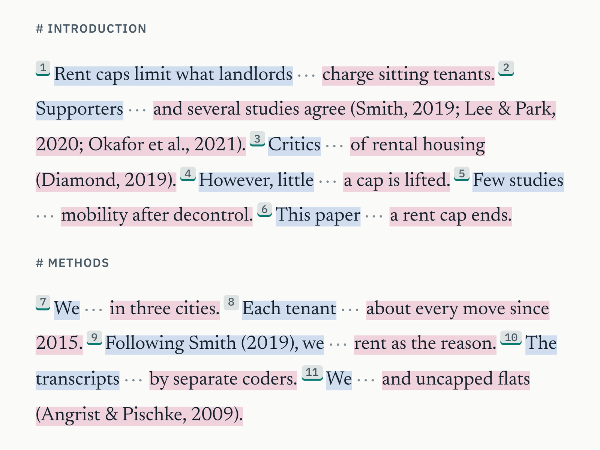

# Topic & Emphasis

[](https://www.repostatus.org/#active)
[](LICENSE)


[](https://github.com/benmarwick/topic-and-emphasis/actions/workflows/ci.yml)

**Topic & Emphasis** is a browser workbench for revising **research writing**. Paste a draft and it marks where the structure of each sentence and paragraph meets, or misses, what readers expect, following Gopen and Swan's ["The Science of Scientific Writing"](https://www.americanscientist.org/node/924) (1990). You then rewrite each sentence in place and watch the notes clear. It is written for **students working on their own**, in the social sciences in particular.

Every mark and note comes from a **fixed rule**. The same text always gets the same marks, and **your draft is never uploaded**. The application is a **single HTML file** whose rules work offline once it has loaded. Everything else is optional, off until you ask for it, and never makes a note: an **optional meaning model**, a small language model that runs entirely in the browser (see below), and **optional data** fetched from the same site (word norms, the Academic Word List, the Academic Formulas List and a phrase bank). The only text that can leave the page is a phrase you select and choose to look up in SkELL or Linggle.

**Use it online:** <https://benmarwick.github.io/topic-and-emphasis/>


---

## 📝 Citation

If you use Topic & Emphasis in teaching or research, please cite it:

> Marwick, B. (2026). *Topic & Emphasis: A revision workbench for research writing* (Version 0.47.0) [Computer software]. https://github.com/benmarwick/topic-and-emphasis

In text: (Marwick 2026).

```bibtex
@software{marwick_topic_emphasis_2026,
  author  = {Marwick, Ben},
  title   = {Topic \& Emphasis: A revision workbench for research writing},
  year    = {2026},
  version = {0.47.0},
  url     = {https://github.com/benmarwick/topic-and-emphasis}
}
```

Please also cite the article the workbench is built on:

> Gopen, G. D., & Swan, J. A. (1990). The science of scientific writing. *American Scientist*, 78(6), 550–558. [Full text](https://www.americanscientist.org/node/924)

---

## 📦 Installation

**Option A: use it online.** Open <https://benmarwick.github.io/topic-and-emphasis/>. Nothing to install.

**Option B: download one file.** Save [`index.html`](index.html) from this repository and open it in a browser. It runs from your own disk. It loads its typefaces from Google Fonts when a connection is available and falls back to system fonts when not. The rules and the built-in word lists all work in a copy saved this way. The optional extras do not, because they are separate files: the meaning model needs `model/`, the second reading in Subject → verb needs `lib/`, and the word norms, the Academic Word List, the Academic Formulas List, the part-of-speech lexicon and the phrase bank need `data/`. For those, use the online copy or serve a clone of the repository from a local web server (`python3 -m http.server`). The two lists can also be pasted into a saved copy by hand.

**Option C: build from source.** The page is assembled from the pieces in `src/` by a short Python script with no dependencies.

```sh
git clone https://github.com/benmarwick/topic-and-emphasis.git
cd topic-and-emphasis
python3 build.py        # writes index.html
for t in tests/*.js; do node "$t" || break; done   # optional: the test files
```

Requires Python 3. The tests need Node.js 18 or later and no packages. `tests/smoke.js` checks the rule engine and `tests/mcp.test.js` the MCP server; the others each cover one feature (readability figures, citations, the main-verb probe, document blocks, the point of a paragraph, the noun unpacker, Word export, the pictures' data, the phrase bank, pasted lists, the two published lists, move order, the nine reviser's checks, the built-in keyword and style lists, and the part-of-speech lexicon).

---

## 🚀 Quick Start

1. **Paste your text**, or choose **Try the example** for seven sentences with five notes to clear. **Tutorial** tours the page and then walks you through them.
2. **Pick a lens** from the list. Each lens reads the draft for one thing and marks it in the text. The Overview shows every open note at once and suggests where to start.
3. **Tap a sentence** to open the workbench under its paragraph. Read the note, rewrite the sentence in the box, and the marks update as you type. Where a note offers a change, preview it before you accept it.
New to revising? Press **Simple view** for eight lenses in three steps, with three notes at a time. A link that ends in `#simple` opens the page that way.

4. **Check your progress** in Before & after, which shows what your revising has changed, and copy the revised text when you are done.

To find a lens, type part of its name in the box above the list. The **Guide** explains every lens on one searchable page: what it reads, what its marks mean, what the research says, where its limits are, and its sources in full.

You do not need to clear every note. A note is a question about the sentence, and "I checked this" is a valid answer.

---

## 🖼️ Gallery

Sixteen of the pictures the page draws. Each is a capture of the real page reading the example draft from its Guide, a short constructed paper on rent caps with one off-topic paragraph about glaciers planted in it. Select a picture to see it at full size (1600 × 1200).

<table>
<tr><th colspan="4" align="left">On the page</th></tr>
<tr>
<td width="25%" valign="top"><a href="docs/gallery/skeleton.png"></a><br><b>Skeleton read</b><br><sub>Skeleton read lens</sub><br>Only the opening and the close of each sentence, so the argument can be read straight down the page.</td>
<td width="25%" valign="top"><a href="docs/gallery/topic-grid.png"></a><br><b>Topic grid</b><br><sub>Topic grid lens</sub><br>Which terms the draft keeps using, and whether each comes before the main verb or after it.</td>
<td width="25%" valign="top"><a href="docs/gallery/paragraph-ladder.png"></a><br><b>Paragraph ladder</b><br><sub>Topic grid lens</sub><br>What each paragraph carries over from the one before, and whether it does so in its first sentence.</td>
<td width="25%" valign="top"><a href="docs/gallery/typographic-rare.png"></a><br><b>Typographic view</b><br><sub>Load map · optional data</sub><br>The text itself as the picture: the rarer a word, the heavier it is set.</td>
</tr>
<tr><th colspan="4" align="left">Load, measures and word choice</th></tr>
<tr>
<td width="25%" valign="top"><a href="docs/gallery/load-strips.png"></a><br><b>Where the load falls</b><br><sub>Load map</sub><br>Sixteen measures of every sentence on one screen, so a sentence that is high on several at once stands out.</td>
<td width="25%" valign="top"><a href="docs/gallery/abstraction-heatmap.png"></a><br><b>Abstraction heatmap</b><br><sub>Load map · optional data</sub><br>Every sentence as a block, darker the more concrete its words.</td>
<td width="25%" valign="top"><a href="docs/gallery/concrete-charged.png"></a><br><b>Abstract or concrete, calm or charged</b><br><sub>Load map · optional data</sub><br>Each sentence placed by how concrete and how arousing its words are.</td>
<td width="25%" valign="top"><a href="docs/gallery/profile-sparklines.png"></a><br><b>Research profile</b><br><sub>Overview</sub><br>Counts from published research, each with a sparkline: the measure for every sentence, at the size of a word.</td>
</tr>
<tr><th colspan="4" align="left">Argument, stance and rhythm</th></tr>
<tr>
<td width="25%" valign="top"><a href="docs/gallery/toulmin.png"></a><br><b>Toulmin layout</b><br><sub>Claim tracer lens</sub><br>The argument as a diagram, drawn from the sentences the writer puts in each box.</td>
<td width="25%" valign="top"><a href="docs/gallery/hedges-boosters.png"></a><br><b>Hedges against boosters</b><br><sub>Hedging lens</sub><br>Caution and confidence side by side for each section, on one scale.</td>
<td width="25%" valign="top"><a href="docs/gallery/draft-as-line.png"></a><br><b>The draft as a line</b><br><sub>Length &amp; rhythm lens</sub><br>Each sentence is a straight run as long as its words, and the line turns right at every full stop.</td>
<td width="25%" valign="top"><a href="docs/gallery/cadence.png"></a><br><b>Cadence without the words</b><br><sub>Length &amp; rhythm lens</sub><br>The rhythm of the draft with the words taken out: a square for each sentence, then only the punctuation.</td>
</tr>
<tr><th colspan="4" align="left">Revision, and the optional meaning model</th></tr>
<tr>
<td width="25%" valign="top"><a href="docs/gallery/revision-arrows.png"></a><br><b>Where each rewritten sentence started</b><br><sub>Load map · after a revision</sub><br>Sentence length against lexical density, with a line from where each rewritten sentence was to where it is now.</td>
<td width="25%" valign="top"><a href="docs/gallery/stage-slope.png"></a><br><b>Open notes by stage, start to now</b><br><sub>Before &amp; after lens</sub><br>A slopegraph of what revising has changed, with every number written on the picture.</td>
<td width="25%" valign="top"><a href="docs/gallery/meaning-topics.png"></a><br><b>Meaning views: Topics</b><br><sub>Meaning views · optional AI</sub><br>A streamgraph of which topic each stretch of the draft is about.</td>
<td width="25%" valign="top"><a href="docs/gallery/meaning-map.png"></a><br><b>Meaning views: Map</b><br><sub>Meaning views · optional AI</sub><br>The sentences laid out so that those close in meaning sit close together.</td>
</tr>
</table>

Several of these follow one source closely. The *Typographic view* and *Cadence without the words* are from Brath’s work on type as a carrier of data (Brath 2020, *Visualizing with Text*). The *Paragraph ladder*, the sparklines of the *Research profile*, the slopegraph of *Open notes by stage* and the small multiples of *Where the load falls* follow Tufte: the data is labelled where it sits, with as little legend, grid and frame as it can do without.

Four of the sixteen use the example after a change, so that there is something to show: *Hedges against boosters* has four confident words added to the draft (clearly, certainly, in fact, clearly), and *The draft as a line*, *Where each rewritten sentence started* and *Open notes by stage* use a copy with five passages rewritten. The *Typographic view*, the *Abstraction heatmap* and *Abstract or concrete, calm or charged* need the optional word norms. *Topics*, *Map* and the two bottom rows of *Where the load falls* need the optional meaning model. `tools/make_gallery.py` takes all sixteen from the page, and the Guide inside the page shows these and the rest.

## 🔧 Feature Reference

### Gopen & Swan's principles

| Lens | What it reads | Drawn from |
|---|---|---|
| Subject → verb | Words that stand between a subject and its verb | [Gopen & Swan](https://www.americanscientist.org/node/924), principle 1; [Gibson (1998)](https://doi.org/10.1016/S0010-0277%2898%2900034-1) |
| Topic position | What opens each sentence, and whether it names the topic | [Gopen & Swan](https://www.americanscientist.org/node/924), principles 3, 4; [Williams (1990)](https://catalog.hathitrust.org/Record/002224980) |
| Stress position | What closes each sentence, where readers place the emphasis | [Gopen & Swan](https://www.americanscientist.org/node/924), principles 2, 7 |
| Old → new | Whether each sentence starts from what the reader already holds | [Gopen & Swan](https://www.americanscientist.org/node/924), principles 4, 6; [Haviland & Clark (1974)](https://doi.org/10.1016/S0022-5371%2874%2980003-4) |
| Action in verbs | Actions hidden in nouns while the verb says little; the sentences that rest on "be", "have" or a light verb, listed | [Gopen & Swan](https://www.americanscientist.org/node/924), principle 5; [Biber & Gray (2010)](https://doi.org/10.1016/j.jeap.2010.01.001); [Hohmann et al. (2025)](https://doi.org/10.1007/s11192-025-05353-8) |

### Is the argument clear?

| Lens | What it reads | Drawn from |
|---|---|---|
| Reverse outline | The first and last sentence of each paragraph, and the point you say it makes | [Mensh & Kording (2017)](https://doi.org/10.1371/journal.pcbi.1005619); [Morris et al. (2025)](https://doi.org/10.1007/s40593-024-00395-0) |
| Paragraph jobs | The job you give each paragraph, and the moves that job usually needs | [Swales (1990)](https://search.worldcat.org/title/23079178); [Academic Phrasebank](https://www.phrasebank.manchester.ac.uk/) |
| Section context | The section each paragraph falls in, read from your headings. Counts by section, and a line on the notes whose advice depends on the section. Raises no notes | [Swales (1990)](https://search.worldcat.org/title/23079178); [Millar et al. (2013)](https://doi.org/10.1093/applin/ams059); Leong (2014) |
| Claim tracer | Where the words of your central claim and your title appear | [Toulmin (2003)](https://doi.org/10.1017/CBO9780511840005); [Mihalcea & Tarau (2004)](https://aclanthology.org/W04-3252/) |
| Claim strength | Causal, certain and absolute wording, against the evidence you name | [Toulmin (2003)](https://doi.org/10.1017/CBO9780511840005); [Haber et al. (2018)](https://doi.org/10.1371/journal.pone.0196346) |
| Hedging | Hedges, and several in a row | [Hyland (1996)](http://hdl.handle.net/10722/130132) |

### Does it flow?

| Lens | What it reads | Drawn from |
|---|---|---|
| Topic grid | Recurring terms across sentences, and how each sentence links back | [Kinnunen et al. (2012)](https://aclanthology.org/E12-2005/); [Crossley, Kyle & McNamara (2016)](https://doi.org/10.3758/s13428-015-0651-7) |
| Signal phrases | Phrases that announce a move, and connectives by type | [Swales (1990)](https://search.worldcat.org/title/23079178); [Knight et al. (2020)](https://doi.org/10.17239/jowr-2020.12.01.06); [McNamara et al. (2014)](https://doi.org/10.1017/CBO9780511894664) |
| Skeleton read | Only the opening and close of each sentence | [Gopen & Swan](https://www.americanscientist.org/node/924), principles 2, 3 |

### Is each sentence easy to read?

| Lens | What it reads | Drawn from |
|---|---|---|
| Length & rhythm | Sentence length on a fixed scale, runs of equal length, readability formulas | [Flesch (1948)](https://doi.org/10.1037/h0057532); [Choi & Crossley (2021)](https://easychair.org/publications/preprint/pgb8) |
| Dense phrases | Noun stacks and chains of prepositions; runs of three nouns shown without a note | [Williams (1990)](https://catalog.hathitrust.org/Record/002224980); [Kyle & Crossley (2018)](https://doi.org/10.1111/modl.12468); [Hohmann et al. (2025)](https://doi.org/10.1007/s11192-025-05353-8) |
| Voice | Passives, and whether each names who acted | [Gopen & Swan](https://www.americanscientist.org/node/924); [McNamara et al. (2014)](https://doi.org/10.1017/CBO9780511894664) |
| Clutter | Stock phrases, empty openers and stacked negatives | [Zinsser (2006)](https://search.worldcat.org/oclc/62421288); [Williams (1990)](https://catalog.hathitrust.org/Record/002224980) |

### Are the words well chosen?

| Lens | What it reads | Drawn from |
|---|---|---|
| Vague & worn words | Intensifiers, vague quantities and worn phrases | [Zinsser (2006)](https://search.worldcat.org/oclc/62421288) |
| Vocabulary level | Content words against two open word lists, and word variety; optionally, words on the Academic Word List by sublist | [Browne, Culligan & Phillips (2013)](https://www.newgeneralservicelist.com/); [McCarthy & Jarvis (2010)](https://doi.org/10.3758/BRM.42.2.381); [Coxhead (2000)](https://doi.org/10.2307/3587951) |
| Term tracker | Recurring terms, second names for one thing, and your own word list | [Williams (1990)](https://catalog.hathitrust.org/Record/002224980); [Kyle, Crossley & Kim (2015)](https://doi.org/10.1075/ijlcr.1.2.01kyl) |
| Acronyms | Abbreviations that are never defined, or used only once or twice | [Barnett & Doubleday (2020)](https://doi.org/10.7554/eLife.60080) |
| Describing people | Labels for people that carry a judgment | [APA bias-free language guidelines](https://apastyle.apa.org/style-grammar-guidelines/bias-free-language) |

### Is it polished?

| Lens | What it reads | Drawn from |
|---|---|---|
| Statistics reporting | Reported test results, rechecked by arithmetic; a count of the figures in each sentence | [Nuijten et al. (2016)](https://doi.org/10.3758/s13428-015-0664-2); [Appelbaum et al. (2018)](https://doi.org/10.1037/amp0000191); [Hohmann et al. (2025)](https://doi.org/10.1007/s11192-025-05353-8) |
| Mechanical checks | Figure and table order, missing citations, tense | [McNamara et al. (2014)](https://doi.org/10.1017/CBO9780511894664) |
| Typing slips | Doubled words, stray spaces, "a" for "an", look-alike words | [Crossley, Bradfield & Bustamante (2019)](https://doi.org/10.17239/jowr-2019.11.02.01) |
| Source overlap | Runs of words shared with a source you paste | [Crossley, Kyle, Davenport & McNamara (2016)](https://asu.elsevierpure.com/en/publications/automatic-assessment-of-constructed-response-data-in-a-chemistry-) |

### Research profile

The Overview carries a **Research profile**: 23 counts, grouped under Structure, Vocabulary and density, Cohesion, and Stance and care. Beside eight of them is a sparkline, a line the size of a word that draws the measure for every sentence, so a figure also shows where it peaks. The profile holds counts that writing researchers use to describe a text, each recomputed here by a fixed rule and each shown with the publication it comes from and a line on how to read it. They describe a draft. None is a score and none has a target. The same counts appear in a "Research measure" box inside the lens they belong to, with what the research found and how the rule-based count differs from the published one.

### Added in 0.7.0: more measures, word lists and word norms

| Where | What | Source |
|---|---|---|
| Length & rhythm | Three more readability formulas beside Flesch-Kincaid, ARI and SMOG: **Coleman-Liau**, **Gunning Fog** and **LIX**, plus the **Dale-Chall** score with the share of words off its list of familiar words. Coleman-Liau, ARI and LIX need no syllable estimate, so they are exact for the text. | [Coleman & Liau 1975](https://doi.org/10.1037/h0076540) · Björnsson 1968 · [Anderson 1983](https://www.jstor.org/stable/40031755) · Gunning 1952 · [Dale & Chall 1948](https://www.jstor.org/stable/1473169) · Chall & Dale 1995 · [Mac et al. 2022](https://pmc.ncbi.nlm.nih.gov/articles/PMC9856555/) |
| Vocabulary level | **Running-word coverage**: the share of all words that are on the NGSL or NAWL, with proper nouns counted apart. | [Nation 2006](https://www.wgtn.ac.nz/__data/assets/pdf_file/0018/1626120/2006-How-large-a-vocab.pdf) |
| Vocabulary level | **Word norms** (optional data, loaded on request): concreteness, age of acquisition, prevalence and frequency of the draft's words, with the most abstract, latest-learned, least-known and rarest words and the most abstract sentences. | [Brysbaert et al. 2014](https://doi.org/10.3758/s13428-013-0403-5) · [Kuperman et al. 2012](https://doi.org/10.3758/s13428-012-0210-4) · [Brysbaert et al. 2019](https://doi.org/10.3758/s13428-018-1077-9) · [Brysbaert & New 2009](https://doi.org/10.3758/BRM.41.4.977) · [van Heuven et al. 2014](https://doi.org/10.1080/17470218.2013.850521) |
| Topic grid | **Thematic progression**: a strip above each paragraph showing whether each sentence keeps the topic of the one before, opens from where it closed, returns to an earlier sentence, or opens on new words. **Referential distance and persistence** for each recurring term. | [Daneš 1974](https://www.coli.uni-saarland.de/~korbay/Courses/esslli04/Scans/danes74.pdf) · [Givón 1983](https://doi.org/10.1075/tsl.3) · Witte 1983 · [Connor & Farmer 1990](https://doi.org/10.1017/CBO9781139524551.013) · [Barzilay & Lapata 2008](https://doi.org/10.1162/coli.2008.34.1.1) |
| Signal phrases | **Transition profile** (a connective before the main verb, only after it, or none), common academic word sequences by function, and four-word runs the draft repeats. | [Biber, Conrad & Cortes 2004](https://doi.org/10.1093/applin/25.3.371) · [Simpson-Vlach & Ellis 2010](https://public.websites.umich.edu/~ncellis/NickEllis/Publications_files/AFL_paper_AppLinxPrepub.pdf) |
| Hedging | **Boosters** and **reader engagement** (reader pronouns, directives, questions, appeals to shared knowledge) counted beside hedges, and underlined in the text. | [Hyland 2005](https://doi.org/10.1177/1461445605050365) |
| Claim strength | **Promotional adjectives** in eight groups, underlined in the text. | [Millar, Batalo & Budgell 2022](https://doi.org/10.1001/jamanetworkopen.2022.28676) |
| Vague & worn words | Words on the **excess-vocabulary** list: style words that became much more common in research abstracts in 2023 and 2024. | [Kobak et al. 2025](https://doi.org/10.1126/sciadv.adt3813) |
| Statistics reporting | **GRIM**: a question on any mean that cannot come from whole-number scores for the sample size in the same sentence. | [Brown & Heathers 2017](https://doi.org/10.1177/1948550616673876) |
| Before & after | Each rewritten sentence is labelled as **wording only**, **content added**, **content removed** or both, and the revision receipt counts each kind. | Faigley & Witte 1981 |

None of these raises a note except GRIM, which asks a question. The word norms keep their authors' non-commercial licences; see [`data/README.md`](data/README.md). The Academic Formulas List was not included at 0.7.0; since 0.18.0 it comes with the page as optional data (see below). References with no link above are books, or articles whose DOI could not be confirmed; their full details are in the page's reference list.

`tests/readability/` holds five fixed passages, this page's figures for them, and two scripts (Python with textstat, R with quanteda.textstats; [Benoit et al. 2018](https://doi.org/10.21105/joss.00774)) that record what those calculators give for the same passages, because readability calculators are known to disagree.

### Added in 0.10.0 to 0.19.0: files, stages, export, pictures, wording and moves

Newest first.

- **The Map draws itself in reading order** (0.47.0). In **Meaning views**, the first time the **Map** is shown its dots come in one at a time in the order of the sentences, each after the line of reading order has reached it, over about six seconds. Each dot now has a thin white halo, so that neighbours and the line stay apart. “Still pictures” and a device's reduce-motion setting show the whole map at once. The **Gallery** on this page has sixteen pictures, in four rows of four, and its pictures, the Guide's and the animation of the tutorial are now taken in the page's own typefaces.

- **A gallery, and a slower animation** (0.46.3). This page has a **Gallery** of twelve pictures, each captured from the real page at 1600 × 1200 with a full alternative text. The animation of the tutorial now holds every step for at least 3.2 seconds. The page itself is unchanged.

- **One card format, and two pictures easier to find** (0.46.2). Every card above the text in every lens now has the same look: a tinted ground and a rule down the left edge. Before, about a third were bare text. The plot *Abstract or concrete, calm or charged* is now one of the views of **Structure and vocabulary** in Load map, beside lexical density, long words, the wait for the verb and word age. *Hedges against boosters* is drawn for every draft of two sentences or more: by section, else by paragraph, else by runs of sentences. The row label in Plainer words reads “Words per sentence”.

- **Four pictures from the word lists** (0.46.0). **Load map** has an *abstraction heatmap*: a block for every sentence, shaded by how concrete its words are, with expressions of several words rated whole once the ratings of [Muraki et al. (2022)](https://osf.io/ksypa/) are loaded. Beside it, a plot places each sentence by concreteness and by arousal. **Hedging** sets hedges against boosters for each section, as bars to either side of one line. **Clutter** shows the reading figures the draft would have with every plainer word put in, without changing it. Every mark has a tooltip and a written value.

- **Four more optional lists, and Hyland's own metadiscourse items** (0.45.0). Each loads at one press, counts only, and makes no note. **Hedging** now counts 478 items from the appendix to Hyland (2005) in his ten categories, in place of the earlier starter set. **Clutter** lists the words of the draft that the US plain-language guidelines (CC0) pair with a plainer one, and **Action in verbs** lists phrases that hide a verb. **Signal phrases** counts connectives by the relation they mark, from [en_dimlex](https://github.com/discourse-lab/en_dimlex) (CC BY-NC-SA 4.0). **Old → new** tells sentences that open “This finding…” from those that open with a bare “This…”, using a list of 959 shell nouns.

- **Charged words and metadiscourse by kind, as optional data** (0.44.0). In **Claim strength**, one press loads ratings of valence, arousal and dominance for 13,915 words ([Warriner et al. 2013](https://doi.org/10.3758/s13428-012-0314-x)) and counts the words of the draft that readers rate as strongly pleasant, unpleasant or arousing. If you have a copy of the NRC VAD Lexicon ([Mohammad 2025](https://arxiv.org/abs/2503.23547)), you can choose the file and the page uses it instead; that lexicon may not be redistributed, so it is not in this repository. In **Hedging**, one press loads a list of metadiscourse items in the ten categories of Hyland (2005) and counts each kind in every 1,000 words. Neither makes a note.

- **Section context, an instructor page, and links that open a step** (0.43.0). **Section context** finds the Abstract, Introduction or Literature review, Methods, Results and Discussion from your headings, counts what each is doing, and adds a line to the notes whose advice depends on the section (a passive in the Methods is usual; a hedge in the Discussion often belongs). It only annotates: no note is added or removed. The **Guide** has a one-page section for instructors, and adding `#step1`, `#step2`, `#step3` or `#tutorial` to the address opens the page already set up. With the meaning model on, the trial paragraph order in Reverse outline also shows closeness in meaning at each join.

- **Hints, what is working, and paragraphs in another order** (0.42.0). A note now gives its advice as **hints**, up to three and only when asked: where to look, what kind of change, and one way to do it. No hint writes the new sentence for you, and “Show all the advice at once” restores the full notes. The page also says **what a sentence already does well** (verb beside its subject, an opening on a known word, a close on something new), in the workbench, in the text and on the Overview. **Reverse outline** lets you drag the paragraphs into another order, shows what each would carry over from the one above, and rewrites the draft only when you ask. A **test and deploy workflow** runs on every push.

- **A Guide brought up to date, and a tutorial that ends in the simple view** (0.41.0). The **Guide** now describes the simple view, the tutorial, the focus timer, the entailment model and the two optional second opinions (a parser and Harper), and its screenshots were made again from the current page, with two added (19 in all). The **Tutorial** ends in the simple view and keeps it for the next visit.

- **A tutorial that tours the page first and keeps out of the way** (0.40.0). The **Tutorial** now opens with eleven short stops before any work is asked for: where a draft goes in, the text, the count of open notes, what an underline means, the lens menu, one lens opened to show its bold and underlined marks, and then the parts of the box where a sentence is rewritten (the sentence bar, the status light, the rewrite box and the note). The part each step is about is lit and pulses, and the rest of the page is veiled. The bubble takes a place beside, under or over that part, or along the bottom of the screen, so that it does not cover it. The page moves once for each step, and the top of the rewrite box comes to the top of the screen.

- **Harper, the entailment model in five more places, and a tutorial in simple view** (0.39.0). *Harper* ([Automattic](https://github.com/Automattic/harper), Apache 2.0), a rule-based grammar and spelling checker, can be loaded in Typing slips; it lists places to look and makes no note. The *entailment model* now also says whether a rewrite changed what a sentence says (Before & after), lists the sentences that read as contradicting your claim and checks each rebuttal against its answer (Claim tracer), reads your closest sentences against the source (Source overlap), and reads the ending against the opening (Meaning views). It is used only on pairs the meaning model puts close together, because it calls some unrelated sentences contradictions. The *tutorial* runs in simple view on four notes, pauses after each note is cleared, and keeps its bubble beside the thing to look at. In simple view, sentence numbers with an open note carry a slow halo.

- **An entailment model, topic shares, and a newer runtime** (0.37.0). An optional *entailment model* ([nli-deberta-v3-xsmall](https://huggingface.co/Xenova/nli-deberta-v3-xsmall), about 90 MB, loaded only when asked for) says of two sentences whether one implies the other, contradicts it, or neither. In Clutter it labels each pair of sentences that are close in meaning as saying the same thing or contradicting each other, which closeness cannot tell apart; in the Toulmin layout it reads each sentence you placed against your claim. It is AI, it is labelled as such, and it makes no note. *Topic shares* (Meaning views, Topics) draws how much of each topic is in each sentence as a stacked band along the draft. The meaning model now runs on Transformers.js 3.8.1, with the same scores as before, and can be asked to try the graphics processor, which it keeps only if a fixed check comes out right. The Academic Word List panel defines its ten sublists, and the ladders draw their joining lines much finer than the lines they join.

- **Meaning steps, a third variable on the scatter, and quieter notes in simple view** (0.36.0). With the meaning model on, Topic grid draws each sentence at its closeness to the one before, as a stem from the level that three-quarters of all sentence pairs in the draft fall below, so the count "closer than most pairs" can be seen sentence by sentence. In the Load map, the dots of *Structure and vocabulary* are larger and sized by a third measure (words before the main verb, or lexical density when the wait is on the upright scale). Pressing a button under *In the text* no longer moves the page away from the text. The Academic Formulas List panel says what its three lists are. In simple view the notes are faint until pointed at.

- **Paragraph ladder, and flying words in simple view** (0.35.0). *Paragraph ladder* (Topic grid) draws what each paragraph carries over from the one before: one line a paragraph, to length on one scale, with its first sentence marked, a dot for each content word the paragraph before also used, and a ring where nothing carries over. It pictures the paragraph-overlap count, the one overlap measure that went with better-rated essays ([Crossley, Kyle & McNamara 2016](https://doi.org/10.3758/s13428-015-0651-7)). The Link ladder in Old → new now sits in a card like the boxes round it. In *Simple view*, the Guide and Practise buttons are back (the Guide covers the eight lenses), and when a rewrite clears a note the words that were cut fly off the page ([canvas-confetti](https://github.com/catdad/canvas-confetti)); this can be switched off and is skipped under reduced motion.

- **Simple view, citations that are not words, a second reading, and more of Toulmin** (0.34.0). *Simple view* is for writers who are new to revising: eight lenses in three steps (is my point clear, does each sentence lead to the next, is each sentence easy to read), three notes at a time, an invented before-and-after example on the notes it fits, a goal for the sitting, and a school-essay example. It hides and changes no rule: the same text gets the same notes (Sommers 1980; [Kellogg 2008](https://doi.org/10.17239/jowr-2008.01.01.1); [Shute 2008](https://doi.org/10.3102/0034654307313795)). *Citations*: an author-and-year citation in parentheses, a year after a name, and a numbered citation in square brackets are now each one token that is not a word, so names and years no longer count towards sentence length or stand between a subject and its verb. *A second reading* (Subject → verb) lists the sentences where a second rule-based parser, [compromise](https://github.com/spencermountain/compromise), disagrees with the page's rules about the main verb, or finds a verb where the rules found none. *Toulmin layout*: with the meaning model on, candidates are ordered by closeness to the claim and a part written in your own words shows the nearest sentence of the draft; each rebuttal can be tied to the sentence that answers it; the layout is drawn as a diagram and can be copied as text. The card beside the introduction is marked by hand-drawn strokes ([Rough Notation](https://github.com/rough-stuff/rough-notation)).

- **Numbers, three-noun runs and weak verbs, shown and not flagged** (0.33.0). Three counts taken from a study of 20 million abstracts in health and medicine ([Hohmann et al. 2025](https://doi.org/10.1007/s11192-025-05353-8)), each added to a lens that already exists and none of them making a note. *Dense phrases* underlines runs of exactly three nouns with dots (a note still starts at four). *Action in verbs* lists the sentences whose main verb is a form of "be" or "have" or a light verb, so that they can be read one after another. *Statistics reporting* gains "Where the numbers are", a count of the figures in digits in each sentence, and the Load map gains a Numbers row. The paper's averages (under 15 words per sentence, about 31 nouns and 11 verbs per 100 words) are shown beside the page's own counts as comparisons for one kind of text in one field, and are not given as ranges. The "About this project" button now matches the badges beside it, the box opens its Corrections section by saying what to expect of fixed rules, and every item in the Licence list links to the work it names.

- **Toulmin layout, folded boxes and quiet drafting** (0.32.0). *Toulmin layout* (Claim tracer) sets your claim out in Toulmin's six parts: grounds, warrant, backing, qualifier, rebuttal and the claim itself. You choose the sentences that do each job, or write the part in your own words when the draft never says it, as is usual for the warrant. The page offers candidates by cue and makes no notes ([Reed & Rowe 2005](https://doi.org/10.1007/s10503-005-4416-9)). In every lens that shows the text, the boxes of pictures and measures now **start folded**, each with a triangle that glows once when the lens opens, so that the text sits near the top; a box you open stays open for the visit. The text box has a **Quiet drafting** switch that hides the live counts while you write (Silvia 2019).

- **A tutorial that dims the rest, more from the meaning model, and Guide screenshots** (0.31.0). While the **Tutorial** runs, everything that is not in play for the step is faded. The **meaning model** (optional, AI, no notes) now also adds two rows to the Load map (jump in meaning, far from your claim), two mappings to the typographic view (closeness to your claim, jumps in meaning), and a list in Clutter of sentences standing apart that are close enough in meaning to be one point made twice. The **Guide** shows 17 more pictures as screenshots, each labelled with what it needs: a revised draft, optional data, or the meaning model (`tools/make_guide_shots.py` regenerates them). In the Load map the typographic controls now sit directly above the text, and *Flip to plain text* is a link in the row above it. Ten of the **quoted sentences** beside the title are by women: Wollstonecraft, Austen, Mary Shelley, George Eliot, Alcott, Dickinson and Woolf.

- **Pictures in the Guide, a larger link ladder, quoted cards and an evidence-based timer** (0.30.0). The **Guide** now says which lenses draw the draft (16 of 31, in 29 pictures) and shows each picture as a small example, drawn by the page's own code from an example draft. The **Link ladder** in Old → new runs the full width, with larger dots and rings, a halo round each, a tooltip on each that names the word, and two lists under it: sentences whose link comes late, and sentences into which no word carries over. **Subject → verb** now marks the subject with a single underline and the main verb with a double one, and each tooltip names the other. **Research measure** boxes start folded, with their headline figure showing. The **Focus timer** offers patterns that have been studied (12 + 3, 25 + 5, 50 + 10, and an open-ended clock with a break sized to the time worked), a twenty-minute break after four rounds, and a summary of the evidence ([Biwer et al. 2023](https://doi.org/10.1111/bjep.12593); [Smits et al. 2025](https://doi.org/10.3390/bs15070861); [Albulescu et al. 2022](https://doi.org/10.1371/journal.pone.0272460); [Sword 2016](https://doi.org/10.1080/1360144X.2016.1210153); Cirillo 2018). Sixteen of the **sentences beside the title** are now quoted word for word from public-domain advice on writing (Strunk 1918, Spencer 1852, Bacon 1625, Schopenhauer 1851, Twain 1894, Carroll 1865, Pope 1711, Jonson 1641, Quiller-Couch 1916), each checked against the Project Gutenberg text and linked to it. Every tooltip that shows one of the writer's sentences now sets it in quotation marks, on a line of its own.

- **A longer tutorial, a focus timer and live counts** (0.29.0). The built-in example now has seven sentences and five notes, and the **Tutorial** button walks through clearing all five: two by a one-tap change, two by rewriting, and one by deciding that the sentence is right as it stands. Each step has a *Show me* button, and a draft of your own is set aside first and brought back at the end. The **Focus timer** counts down 10, 15, 25 or 45 minutes in the corner of the page, then reports what changed and offers a five-minute break. The box where a draft is typed shows **live counts**: words, sentences, paragraphs, words per sentence, the longest sentence, sentences of 30 words or more, the longest wait for a verb, and the notes waiting. *Clean view* and *Fingerprints* now sit with the other buttons above the text, and fingerprints show in every lens that shows the text. The Research profile starts folded. The sentences beside the title each state an idea from a source the page cites, in the page's own words.

- **Five pictures from tools for reading and teaching, and an information box** (0.28.0). *Cohesion map* (Topic grid): the main terms round a ring, joined where one sentence uses two of them; terms that no sentence ties to the main group stand apart in amber ([Lachner, Backfisch & Nückles 2018](https://doi.org/10.1007/s11423-018-9571-4)). *Argument board* (Claim tracer): the writer says what each paragraph does for the claim (supports, qualifies, answers an objection, background) and the page draws the result and asks about its shape ([Chang, Lin & Hwang 2025](https://doi.org/10.3389/feduc.2025.1672105)). *The reader's skim* (Signal phrases): only the sentences that signal a move, with the unsignalled sentences counted between them ([Fok et al. 2023](https://arxiv.org/abs/2205.04561)). *Words that mark out each part* (Term tracker): the distinctive words of each section in parallel alphabetical columns, by log-likelihood, with a line where neighbouring columns share a word; also the starting draft against the draft now (Collins, Viégas & Wattenberg 2009). *Where each source is cited* (Mechanical checks): a row a source, a column a paragraph (Hearst 1995; [Chang et al. 2023](https://arxiv.org/pdf/2302.07302)). All five are counts and pictures; none makes a note. An **information button** at the upper right opens a box with the author, the citation, where to send corrections, the licences and details of how the page works. The stage buttons now also narrow the marks in the Overview, and every button on the page has a tooltip that says what it does.

- **Three well-known pictures of text** (0.27.0). *The draft as a line* (Length & rhythm): one straight run a sentence, as long as its word count, turning right at every full stop, with the starting draft drawn faintly behind; after Stefanie Posavec's sentence drawings (*Writing Without Words*). *Word tree* (Term tracker): every use of a chosen term with what follows it, or what comes before it, merged into branches where the wording is shared (Wattenberg & Viégas 2008, *IEEE TVCG* 14(6)). *Phrase net* (Dense phrases): the content words the draft joins with "of", "and" or "is", as rows and arcs (van Ham, Wattenberg & Viégas 2009, *IEEE TVCG* 15(6)). The net is laid out as rows, not by a force simulation, so the same draft always gives the same picture. Rule-based; no notes.

- **Mosaics, a term index, and more typographic mappings** (0.26.0), after [Brath & Banissi (2016)](https://doi.org/10.1016/j.sheji.2016.05.003). *What your sentences do* (Action in verbs): every main verb as a word, grouped as be and have, reporting, light verbs and other actions, heavier the more sentences it leads and italic when mostly passive. *Whose story the draft tells* (Topic position): every grammatical subject as a word, grouped as I and we, pointing words, other pronouns, actions named as things, and people and things named. *Term index, in type* (Term tracker): the repeated terms in alphabetical order, heavier for more uses, small capitals for claim words, italics for a term that stays in one paragraph. *Typographic view* (Load map) gains *the parts of each sentence* (opening italic, subject in small capitals, verb heavy), which also prints in black and white, and *load, sentence by sentence*; for the weight mappings the words can be held in place by drawing weight as stroke, so that flipping to plain text moves nothing.

- **Five pictures made of text** (0.25.0), after Brath (2020, *Visualizing with Text*) and [Brath & Banissi (2016)](https://doi.org/10.1016/j.sheji.2016.05.003). *How your sentences open* (Topic position): a stem-and-leaf plot of words, each stem a word that opens more than one sentence and each leaf the words that follow. *Repetition, drawn* (Term tracker): each paragraph as a line of words with an arc from each use of a content word to its next. *Cadence without the words* (Length & rhythm): one square a sentence, darker the longer it is, and the punctuation alone. *Outline with proportions* (Reverse outline): each paragraph's first sentence or stated point, with a quantity (share of words, open notes, wait for the verb, claim words) set into the line as a length of heavy type. All are rule-based counts and none makes a note.

- **Measures in and beside the text** (0.24.0). *Fingerprints* (Overview): six small cells beside each sentence, shaded by its rank in the draft for length, wait for the verb, density, long words, new words and nouns from verbs, after the sentence-level views of [Oelke et al. (2012)](https://doi.org/10.1109/TVCG.2011.266) and [Keim & Oelke (2007)](https://doi.org/10.1109/VAST.2007.4389004). *Profile* (a new workbench tab): one sentence against the whole draft, measure by measure, with the draft's middle marked and a ring where the sentence started. *Trunk view* (Subject → verb): subject, verb and close in full ink; openers, interruptions and comma-set asides lighter; with the meaning model on, each lighter part is graded by how much meaning the sentence loses without it. It follows the idea of [Gu et al. (2024)](https://arxiv.org/abs/2401.10873) and is not their method, which needs a large language model. *Facets by paragraph* (Load map): words, syntax, cohesion and stance as rows, paragraphs under their headings as columns ([Graesser et al. 2011](https://doi.org/10.3102/0013189X11413260)). *Scatter*: wait for the verb and part-of-speech density as upright scales, and a line from where each rewritten sentence started. *Typographic view* (Load map): the words set by a measure, one at a time: how common each is, new or repeated, syllables, part of speech, age learned, concreteness (Brath 2020, *Visualizing with Text*; [Brath & Banissi 2016](https://doi.org/10.1016/j.sheji.2016.05.003)). None of these makes a note.

- **Three more pictures from the meaning model** (0.23.0; optional, labelled AI, no notes). *Old → new*: a given-new ribbon, described in the table below. *Reverse outline*: every sentence ranked by how far it sits below its own paragraph. *Meaning views, Abstract & ending*: the sentences that set the draft going (the claim, and sentences signalling a gap or an aim) joined to the sentences of the last paragraph closest to them, with open circles for what is not returned to and what appears only at the end. Each mark has a tooltip with the sentences and the scores behind it. Tested first on small sets: the given-new measure picked the chain in five joins of six and in one of six when shuffled; a planted sentence was ranked lowest in seven paragraphs of nine; the model scores an ending that reports the opposite finding almost as close as one that answers the aim, and the page says so.

- **A part-of-speech lexicon** (0.22.0, optional data). The lexicon of the Brill tagger ([Brill 1992](https://doi.org/10.3115/974499.974526)), as packaged in [words/brill](https://github.com/words/brill) (MIT): about 54,000 words with the parts of speech each can take, 670 KB, loaded on request. *Subject → verb* lists the sentences where the lexicon and the rules disagree about the main verb: a word the rules took as the verb that has no verb reading, and a likely finite verb in a sentence where the rules found none. *Dense phrases* counts lexical density the published way, by part of speech, with the ratio of nouns to lexical verbs. The page has the lexicon and none of the tagger's contextual rules, so each word takes its most likely class. It changes no note and no mark. `tests/pos.test.js`.

- **The Academic Keyword List, and four open lists** (0.21.0). The AKL ([Paquot 2010](https://uclouvain.be/en/research-institutes/ilc/cecl/the-academic-keyword-list-akl), *Academic Vocabulary in Learner Writing*, Continuum, 56–58) is published under CC BY 4.0, so it is built into the page whole: 928 entries in five classes, multi-word entries included. *Vocabulary level* reports the share of running words that are AKL nouns, verbs, adjectives or adverbs, by class, with the words used most. Four MIT-licensed lists from [github.com/words](https://github.com/words) are also built in and only counted: a wider list of hedges (*Hedging*, showing the words this page's own rule does not mark), weasel words and buzzwords (*Vague & worn words*), and fillers (*Clutter*). None raises a note. `tests/akl.test.js`.

- **Nine questions a reviser asks** (0.20.0). Checks drawn from Pat Thomson's revision strategies (Kamler & Thomson 2014, *Helping Doctoral Students Write*; Thomson 2023, *Refining Your Academic Writing*; and her blog [patter](https://patthomson.net/category/academic-writing/)), each read from a surface cue and each asking a question. *Paragraph jobs*: a paragraph in which sentence after sentence opens with a cited author, one where the writer's own work appears only in the last sentence, and one that ends on a quotation; a panel counts sentences led by a source against sources kept in brackets (the integral and non-integral citations of Swales 1990). *Mechanical checks*: a bracket holding five or more sources. *Hedging*: a sentence that hedges its claim and limits its reach at once. *Term tracker*: an abstract term used three times or more and never explained (the "code words" of Flower & Hayes 1977, *College English* 39(4)), with counts of reporting verbs and repeated sentence openers. *Old → new*: a paragraph joined to the last only by "Furthermore" or "In addition". *Signal phrases*: the share of sentences that talk about the text itself (Hyland 2005; Haag 2021, *Revise*), counted with no note. *Voice*: a paragraph told almost wholly in passives with no agent. The thresholds are working values. `tests/patter.test.js`.

- **Open a file.** "Open a file", or drag a file onto the page: Word (.docx), Markdown, Quarto (.qmd), R Markdown, LaTeX and plain text. A .docx file is unpacked in the browser by about forty lines of code in the page, so there is no upload and no added library; headings are kept, and footnotes, comments and tracked deletions are left out.
- **Parts that are not prose are set aside.** The settings block of a Quarto file, code blocks, displayed equations, layout markup, block quotations and the reference list stay in the text, greyed and labelled, and no lens reads them. Inline code, inline maths, web addresses and LaTeX references are not counted as words. Nothing is removed, so the text you copy back out is the text you put in.
- **Reference list check** (Mechanical checks). The list under a References or Bibliography heading is compared with the author-and-year citations in the text: cited but not listed, a year that differs, and listed but never cited.
- **Move order, move position, and the moves as rows** (0.19.0). Three things taken from how [AcaWriter](https://github.com/uts-cic/acawriter) ([Knight et al. 2020](https://doi.org/10.17239/jowr-2020.12.01.06)) turns move tags into feedback, read here from cue phrases by fixed rules. *Order*: a note when a gap is signalled before the context, or, in an abstract, a method before the aim, a result before the method, or an implication before the result. *Position*: a note when a paper first signals its aim late or signals no closing move near the end, when an introduction carries on well past its aim, or when an abstract does not close on a finding. *Picture*: Signal phrases draws one row for each move and one column for each sentence, so a text in the usual order steps down from left to right; for an introduction the rows are Swales's three moves. Each note is a question and can be marked as checked.
- **The Academic Word List and the Academic Formulas List, as data** (0.18.0). Both now come with the page as optional JSON in `data/lists/`, holding word strings and numbers only: 570 headwords with their families and sublists, and 607 formulas with their list, frequencies per million and formula teaching worth. One button in Vocabulary level and one in Signal phrases loads each. The names of UEFAP's 35 rhetorical functions are in `data/taxonomy/`, with this project's tagging of the phrase bank's groups, and the Phrases tab can be filtered by function. `data/README.md` sets out where each file was read from, how the formulas were cross-checked, and the position on rights.
- **Pasting a list of your own** (0.17.0). Paste a copy into the Vocabulary level lens (word list) or the Signal phrases lens (formulas) and the page counts and marks the words and formulas of the draft that are on it: by sublist for the word list ([Coxhead 2000](https://www.wgtn.ac.nz/__data/assets/pdf_file/0020/1626131/Coxhead-2000.pdf)), and by list and formula teaching worth for the formulas ([Simpson-Vlach & Ellis 2010](https://public.websites.umich.edu/~ncellis/NickEllis/Publications_files/AFL_paper_AppLinxPrepub.pdf)). British and American spellings are matched to each other. The copy stays in the browser, raises no notes and does not change the revision receipt. `data/README.md` gives the formats.
- **Phrase bank** (0.16.0, optional data). A *Phrases* tab in the workbench holds about 590 sentence frames in 57 groups ("indicating the gap in knowledge", "admitting limitations"), each with blanks to choose and dots to fill. It opens on the frames that fit the paragraph's job or the move the sentence signals, and notes that link to the Phrasebank open it too. The frames are from [Wallwork 2016](https://doi.org/10.1007/978-3-319-26094-5), as prepared in the open-source package [academic-phrases](https://github.com/nashamri/academic-phrases) with the permission of Springer Nature and the author. They are licensed GPL-3.0, kept in `data/phrases/` apart from the MIT-licensed page, fetched only on request, and can be deleted. This is the page's answer to the "see examples" step of the Research Writing Tutor ([Cotos, Huffman & Link 2020](https://doi.org/10.17239/jowr-2020.12.01.07)): a move leads to frames for that move. The page has no annotated corpus and cannot compare a draft with a discipline.
- **Where to find wording** (0.15.0). The page asks questions and leaves the words to the writer, so it now points to places where wording can be found, with a citation for each. *Phrases by purpose*: notes link to the matching page of the [Academic Phrasebank](https://www.phrasebank.manchester.ac.uk/) and of [UEFAP's rhetorical functions](https://www.uefap.org/writing-functions-introduction/). *A phrase in real use*: a line under the rewrite box sends the words you select (eight at most, and nothing else) to [SkELL](https://skell.sketchengine.eu/) ([Baisa & Suchomel 2014](https://nlp.fi.muni.cz/raslan/2014/12.pdf)) or [Linggle](https://linggle.com/) ([Boisson et al. 2013](https://aclanthology.org/P13-4024/)), or copies them for [Ludwig](https://ludwig.guru/). The Guide adds the student corpora MICUSP (University of Michigan 2009; described by Römer & O'Donnell 2011, *Corpora* 6(2)) and BAWE ([Alsop & Nesi 2009](https://doi.org/10.3366/E1749503209000227)); the books of [Swales & Feak 2012](https://doi.org/10.3998/mpub.2173936), [Glasman-Deal 2020](https://doi.org/10.1142/q0232) and Graff & Birkenstein 2024; what academics accept as reuse of a stock phrase (Davis & Morley 2015, *Journal of Second Language Writing* 28); and the move-reading tools of [Cotos, Huffman & Link 2015](https://doi.org/10.1016/j.jeap.2015.05.004) and [Knight et al. 2020](https://doi.org/10.17239/jowr-2020.12.01.06). No phrase list from any of these is copied into the page.
- **Pictures of the draft** (0.14.0). Each is drawn from the draft's own counts, on one scale, in inline SVG or plain HTML, with no library and no decoration (after Tufte 1983, 2006). *The draft at a glance* (Overview): one column a sentence, its length above the line and its open notes below; tap a column to open the sentence. *Load map*: five new rows for where the open notes, claim words, named evidence, strong wording and hedges sit. *Link ladder* (Old → new): a small picture for each paragraph, every sentence drawn to length with its opening and close marked and a line from each repeated word back to where it stood in the sentence before; links that land in the opening are blue. *Openings and closes, side by side* (Skeleton read): a two-column ledger with a rule as long as the words left out. *Paragraph map* (Paragraph jobs): job, length, a square for each word of the claim, and the point. *Wording against evidence* (Claim strength, Hedging): a table of sentences by strong or hedged wording and by whether a citation or figure is in the sentence. *Open notes by stage* (Before & after): a slopegraph from the start to now. In the workbench, an arc joins the subject to its verb, taller the further apart they are. Movement (0.14.1): each picture draws itself in once when you arrive at a lens or open a text, and holds still while you type; the arc moves to its new shape as you edit, glows amber from eight words apart, pulses slowly from twelve, and the subject and verb flash once when they meet. "Still pictures" under Reading comfort, or the device's reduce-motion setting, switches all of it off.
- **Export** (0.13.0). *Take the draft with you* saves the current text as a Word file in which every open note is a comment in the margin, attached to the words it points at, with its question first; as a Word file with no comments; or as a plain file in the format you opened. The .docx is written in the browser by about forty lines of code in the page (a ZIP of five small XML parts, stored uncompressed), so there is no upload and no added library. It is a plain file: headings, paragraphs, quotations and the reference list, without the fonts, footnotes, figures or tables of the original. The *revision portfolio* now also holds the reverse outline (main claim, each paragraph's job, your stated point and its opening words) and the notes still open, and it saves as a web page or Markdown, or prints, so it can go to a supervisor or a writing centre with the draft. Inside the Claude viewer, where ordinary downloads are blocked, the page asks the viewer to save the file; where nothing can be saved, copying still works.
- **Sentence tools in the workbench** (0.12.0). *Rearrange* cuts the sentence into labelled pieces (opening, subject, interruption, verb, middle, close), marks the pieces that bring in a word the draft has not used before, and after each move sets the sentence before against the sentence now: how it opens, how far the subject sits from its verb, and what it closes on. Notes about a subject far from its verb, a weak close, or new before old open it with one button. *Unpack the noun* appears in the "action is in a noun" note: three blanks (who or what, did what, to what), with the verb and its object filled from the writer's own words and the actor left empty unless the sentence names one after "by" or as a possessive. A preview shows which notes the new wording would clear. Neither tool writes a sentence for the student: both assemble the student's own words, and the result is a rough draft to read over.
- **Four stages of revising** (0.11.0). Buttons above the lens list narrow the page to Argument, Flow, Polish or Calibration, hiding the other lenses and their notes. Each button shows its open notes. Pressing "I have reviewed this stage" ticks it, outlines the next one and records the order in the portfolio. Nothing is locked: one line appears if you start polishing while the argument stage is unreviewed and still has open notes, and you can carry on.
- **Revision portfolio** (Before & after). The receipt, the research profile at the start and now, every rewritten sentence with its kind of change, the notes weighed and kept with the reasons given, and a written reflection, copied as Markdown or JSON.
- **Stress position.** A short bracketed aside at the end of a sentence is now set aside like a citation, and a few more weak endings are recognised ("in part", "to some degree", "on the whole").
- 0.9.2 and 0.9.3: better main-verb and passive rules with a probe test, and "this + noun" counted as pointing back.

### Added in 0.9.0: the Load map, lexical density, and sparklines

- **Load map** (a new lens beside the Overview). Three pictures of the whole draft, built on Tufte's small multiples, sparklines and range-frame (Tufte 1983, 2006):
  - *Where the load falls*: one column per sentence and one strip per measure (length, wait for the verb, lexical density, long words, new words, nouns made from verbs), on a shared axis. The tallest fifth of each strip is coloured, and a last strip counts how many loads each sentence carries at once.
  - *Structure and vocabulary*: every sentence as a dot, by its length and its density, with the middle of each scale marked, so the draft's long-but-plain sentences separate from its short-but-dense ones. The two-way view follows [Jenset (2026)](https://communities.springernature.com/posts/the-myth-of-the-unreadable-humanities-and-social-sciences).
  - *Paragraph by paragraph*: one table row per paragraph, with a sparkline of its sentence lengths and of its waits for the verb.
- **Lexical density** (Dense phrases, Research profile, MCP): the share of words that carry content, for the draft, each paragraph and each sentence ([Johansson 2008](https://journals.lub.lu.se/LWPL/article/view/2273), after Ure 1971 and Halliday 1985). It is counted without a part-of-speech tagger, and on the CLEAR passages it had no relation to judged ease (−0.02), so the page presents it as packing and not as difficulty.
- **Citation keys** (0.8.1): `@Marwick2026`, `[@a; @b, p. 4]` and LaTeX `\cite` commands are read as citations.

### Added in 0.8.0: cleaner readability figures, science jargon, and a check on the counts

- **Readability on cleaned text.** Before the formulas run, bracketed citations, numbers, abbreviations and stray single letters are dropped and hyphenated words are split, as [Plavén-Sigray et al. (2017)](https://doi.org/10.7554/eLife.27725) did for 709,577 abstracts. The box also gives the figures for the text as typed.
- **Syllables.** A better spelling rule, backed by counts from the [CMU Pronouncing Dictionary](https://github.com/cmusphinx/cmudict) for 1,961 common words the rule gets wrong. On the test passages the figures now sit within about half a grade of quanteda.textstats.
- **General science jargon** (Vocabulary level): the share of words on the 2,138-word list of [Plavén-Sigray et al. (2017)](https://doi.org/10.7554/eLife.27725), with the words used most.
- **Sentences with the hardest vocabulary** (word norms): the three sentences whose content words are learned latest, following the per-sentence averages of [Lee & Lee (2023)](https://aclanthology.org/2023.bea-1.1).
- **What the counts track** (Guide, and [`tests/validation/RESULTS.md`](tests/validation/RESULTS.md)): the correlation of each count with teachers' judgements of reading ease on 4,721 passages of the CLEAR corpus ([Crossley et al. 2023](https://doi.org/10.3758/s13428-022-01802-x)). The best single count reaches about 0.6, word variety and sentence overlap are near zero, and all counts together reach 0.73. The corpus is not in the repository; `tests/validation/clear.js` reproduces the table from its CSV file.
- **Weasel words** (0.7.1): notes on views attributed to nobody, vague degree words and comment words; the lens search and the Guide find all five lenses that cover them.

### Meaning model (optional)

Switched off unless the student turns it on. It loads a small sentence-embedding model, all-MiniLM-L6-v2 ([Reimers & Gurevych 2019](https://doi.org/10.18653/v1/D19-1410); [Wang et al. 2020](https://papers.nips.cc/paper/2020/hash/3f5ee243547dee91fbd053c1c4a845aa-Abstract.html)), from the `model/` folder and compares sentences by meaning, following the methods set out by [Kjell, Giorgi & Schwartz (2023)](https://doi.org/10.1037/met0000542). It is a trained language model and therefore a form of AI. It runs in the browser, generates no text, and gives the same result for the same text. The first use downloads about 45 MB.

| Lens | What the model adds |
|---|---|
| Subject → verb | In the trunk view, each opener, interruption and aside is graded by how close the sentence stays to the whole without it, and sentences whose trunk alone says least of the whole are listed |
| Topic grid | Sentences that are close in meaning to the one before but repeat none of its words; how close each paragraph is to the one before, and the weakest join in the draft |
| Old → new | A ribbon picture of each paragraph. Each sentence is divided at its main verb into an opening and a close, and the opening is compared with the close and the opening of the sentence before: a ribbon where it picks up the last close, a dashed line where it keeps the last opening, an amber line where it reaches further back, an open circle for a fresh start |
| Reverse outline | The sentence closest in meaning to the rest of its paragraph, and whether it sits at an edge; the sentence that best carries the point you stated; a strip of dots and a table ranking every sentence of the draft by how far it sits below its own paragraph |
| Claim tracer | The sentence that states your claim most directly, in your words or others; how close each paragraph is to the claim |
| Source overlap | Your sentences closest in meaning to a source sentence, including restatements that share no run of words; the parts of the source the draft says least about |
| Term tracker | The closest pairs in meaning among your terms, as candidates for two names for one thing |
| Before & after | How far each rewritten sentence has moved in meaning from the one it replaced |
| Rewrite box | Two live gauges: how close the sentence you are rewriting is to the one before it, and to your claim |

With the model on, the **Meaning views** lens draws the whole draft in eight ways:

| View | What it shows |
|---|---|
| Thread | Each sentence's closeness to the one before, across the draft, with a second line for closeness to the claim; jumps inside paragraphs, paragraph breaks with no jump, and distant sentences that say nearly the same thing |
| Quilt | Every sentence against every other, shaded by closeness; tap a square to read the two sentences |
| Topics | The model's grouping of sentences into topics, as a band of colour, with how often the topic changes |
| Map | Sentences as dots on a flat map joined in reading order, with the claim and the earlier positions of rewritten sentences. A two-dimensional map distorts, and the view says how much |
| Reorder | Move paragraphs and watch the joins between them; compare with the model's smoothest order; apply an order to the draft |
| Ask | Type a question or a reader's comment and jump to the sentences closest to it. Nothing is generated |
| Abstract & ending | Whether the last paragraph returns to the first, and which paragraphs a pasted abstract says least about |
| Drills | "Which sentence belongs least?" and "Put the paragraph back in order", built from the draft |

The model does not see negation or logic, and its scores only rank things within one draft, so nothing it reports is a pass or a fail. Its results appear as labelled lines, lists and tables. They never become notes, and they do not change the counts of open notes or the revision receipt, which stay rule-based.

### Working on a draft

| Feature | What it does |
|---|---|
| Workbench | Rewrite a sentence in place; marks from every open note show inside the box |
| Previews | See which notes a suggested change would clear, and any it would bring in, before accepting it |
| Rearrange | Drag the labelled parts of a sentence into a new order; a table shows what the move did to the opening, the subject-to-verb distance and the close |
| Profile | Why this sentence is heavy: each measure for the sentence on the draft's own range, with the draft's middle and the lens to open |
| Unpack the noun | A fill-in template that turns a noun such as "implementation" back into a verb and leaves the actor for the writer to supply |
| Phrases | About 590 sentence frames in 57 groups, opening on the group that fits the paragraph's job or the sentence's move (optional data) |
| Phrase look-up | Sends the words you select, eight at most, to SkELL or Linggle to see them in real use, or copies them for Ludwig |
| Four stages | Narrow the page to argument, flow, polish or calibration, and record each stage as reviewed |
| Guided and timed passes | Walk through the notes one at a time, or work for 5, 10 or 20 minutes |
| Before & after | A revision receipt, counts by lens, and the starting text against the current one |
| Export | The text as a Word file with each open note as a margin comment, as a Word file with no comments, or as a plain file; the revision portfolio as a web page, Markdown, JSON or print |
| Practice | Short drills on the principles, some built from your own draft |
| Reading comfort | Text size, spacing and colour settings |

Each citation above links to its DOI or to the full text where one could be confirmed. Books, and articles whose DOI could not be confirmed, are named without a link. All 178 sources are listed at the foot of the application, 77 of them with a DOI and 67 more with a link to the full text or the publisher's page.

---

## 🔌 MCP Server

The repository includes a small [Model Context Protocol](https://modelcontextprotocol.io/) server, so that an AI agent can use the same fixed rules as the page. It is meant for three jobs: a **tutor** that asks a writer each note's question and lets them revise, a **grader's aid**, and **batch analysis** of a set of drafts for research. It runs on your own machine over stdio, needs only Node.js 18 or later, has no dependencies, opens no network connection and writes nothing to disk. It uses the word norms when the four files are in `data/norms/`. The meaning model, the Academic Word List, the Academic Formulas List and the phrase bank are not part of it.

Add it to an MCP client with a configuration like this, using the full path to your copy:

```json
{
  "mcpServers": {
    "topic-and-emphasis": {
      "command": "node",
      "args": ["/full/path/to/topic-and-emphasis/mcp/server.js"]
    }
  }
}
```

| Tool | What it does |
|---|---|
| `list_lenses` | Lists the lenses with a line on what each reads |
| `describe_lens` | Explains one lens in full: what it reads, its marks, the research, its limits, and its sources with DOIs |
| `analyse_draft` | Returns the notes on a draft. By default it returns only each note's **question**, for a tutor to ask. With `reveal: "full"` it adds the finding, explanation, advice and any suggested change, and for a noun that hides an action the parts of the unpacking template (`unpack_the_noun`). Can be limited to chosen lenses or one sentence |
| `research_profile` | Returns the descriptive counts for a draft |
| `compare_drafts` | Compares two versions: notes in each lens before and after, and both profiles |
| `analyse_batch` | One row per draft for up to 200 drafts, with a CSV copy. No draft text is returned |

The server tells the agent how it is meant to be used: ask the question, do not rewrite for the writer, check notes against the text, and treat no count as a score. Those are instructions to the agent and not a guarantee of how it will behave.

The lens descriptions the server gives come from `mcp/guide.json`, which is exported from the page. After changing the lenses, regenerate it with `python3 build.py && python3 mcp/export_guide.py` (this step needs the Python package `playwright` and Chrome). Test the server with `node tests/mcp.test.js`.

---

## ⚠️ Limits

The rules read structure and have no idea what your sentences mean. There is no parser, no part-of-speech tagger (the optional lexicon lists what a word can be, and does not read it in context) and no spelling dictionary, so some sentences will be misjudged, synonyms are not recognised (unless the meaning model is on), and misspellings are not found. The word lists say how common a word is and nothing about what it means. Moves are read from cue phrases, so a move made without one is not seen. The working thresholds (for example, twelve words before the main verb, or five matching words in a row) are this tool's own values and are labelled as such in the application. They are not published norms.

---

## 🧪 Tests and deployment

`python3 build.py` builds `index.html` from `src/`. The tests are plain Node scripts with no dependencies:

```sh
for t in tests/*.js; do node "$t"; done
```

`.github/workflows/ci.yml` runs the build and the tests on every push and pull request, and fails if the committed `index.html` is not the built page. On a push to `main` that passes, it publishes the site to GitHub Pages. For that last step, set **Settings → Pages → Build and deployment → Source** to **GitHub Actions**. The animation at the top of this page is made by `tools/make_tutorial_gif.py` and the pictures in the gallery by `tools/make_gallery.py`. Both, and `tools/make_guide_shots.py`, should be run on a machine that has the page's typefaces (Newsreader, IBM Plex Sans, IBM Plex Mono) or can reach Google Fonts; `tests/readme.test.js` checks that every picture named here exists and has an alternative text.

## 💬 Getting Help and Contributing

- Report a problem or suggest a rule in the [issue tracker](https://github.com/benmarwick/topic-and-emphasis/issues). A sentence the rules misread is especially useful: paste the sentence and say which lens marked it.
- Changes are recorded in the [changelog](CHANGELOG.md).
- The source is four files in `src/`: `head.html` (styles), `body.html` (page structure), `engine.js` (the rules) and `ui.js` (the interface), with eight word-list files beside them as `.txt` files. Optional data is in `data/` and is rebuilt by the scripts in `tools/`. Run `python3 build.py` and every file in `tests/` before opening a pull request.

---

## 🤖 Generative AI Disclosure

The code of this application was written with the assistance of an AI coding tool (Claude, by Anthropic), under the direction of the developer, who chose the sources, set the design and the constraints, and is responsible for the result. Every mark and note the application makes comes from a fixed rule in `src/engine.js`. The one exception is the optional meaning model described above, which is off by default and labelled as AI wherever its results appear.

---

## ⚖️ License

[MIT](LICENSE) © 2026 Ben Marwick.

The application includes the **New General Service List** and the **New Academic Word List** (version 1.2 of each) by Charles Browne, Brent Culligan and Joseph Phillips, under a [Creative Commons Attribution-ShareAlike 4.0](https://creativecommons.org/licenses/by-sa/4.0/) licence. The typefaces (IBM Plex and Newsreader, SIL Open Font License) are loaded from Google Fonts when the page opens and are not included in this repository.

The `data/` folder holds third-party word lists and word norms under their own licences, set out in [`data/README.md`](data/README.md). The **Academic Keyword List** (Paquot 2010) is included under **CC BY 4.0**. The Dale-Chall list, the excess-vocabulary list, the science-jargon list and the four lists from github.com/words (hedges, weasels, fillers, buzzwords) are MIT-licensed, and the syllable counts come from the CMU Pronouncing Dictionary (BSD 2-clause). The phrase bank in `data/phrases/` is under the **GNU GPL 3 or later**; it is kept apart from the application and loaded only on request. `data/lists/awl.json` and `data/lists/afl.json` hold the words and figures of the Academic Word List (Coxhead 2000) and the Academic Formulas List (Simpson-Vlach & Ellis 2010) and nothing else from those publications; no permission was sought for either, and `data/README.md` sets out the position taken and how to remove them. The four word-norm files in `data/norms/` are for **non-commercial use only** (CC BY-NC-ND 3.0 and CC BY-NC-SA 4.0) and are loaded only on request; delete that folder if you need a copy for commercial use.

The optional entailment model in `model/nli-deberta-v3-xsmall/` is a conversion of cross-encoder/nli-deberta-v3-xsmall, which is built on Microsoft's DeBERTa (MIT). The `model/` folder also holds third-party files used only by the optional meaning model: the **all-MiniLM-L6-v2** sentence-embedding model in its ONNX conversion (Apache-2.0), the **Transformers.js** library (Apache-2.0), and the **ONNX Runtime Web** engine it includes (MIT). The `lib/` folder holds **compromise** (MIT) and **Harper** (Apache-2.0), and `src/vendor/` holds **Rough Notation** bundled with the parts of **Rough.js** it uses (MIT) and **canvas-confetti** (ISC); [`lib/README.md`](lib/README.md) gives the versions.
